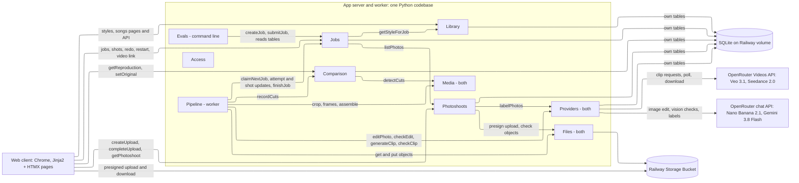
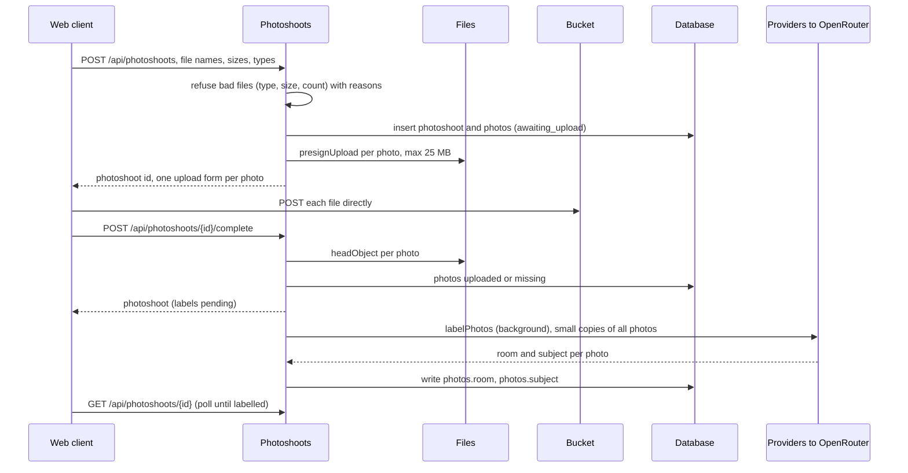
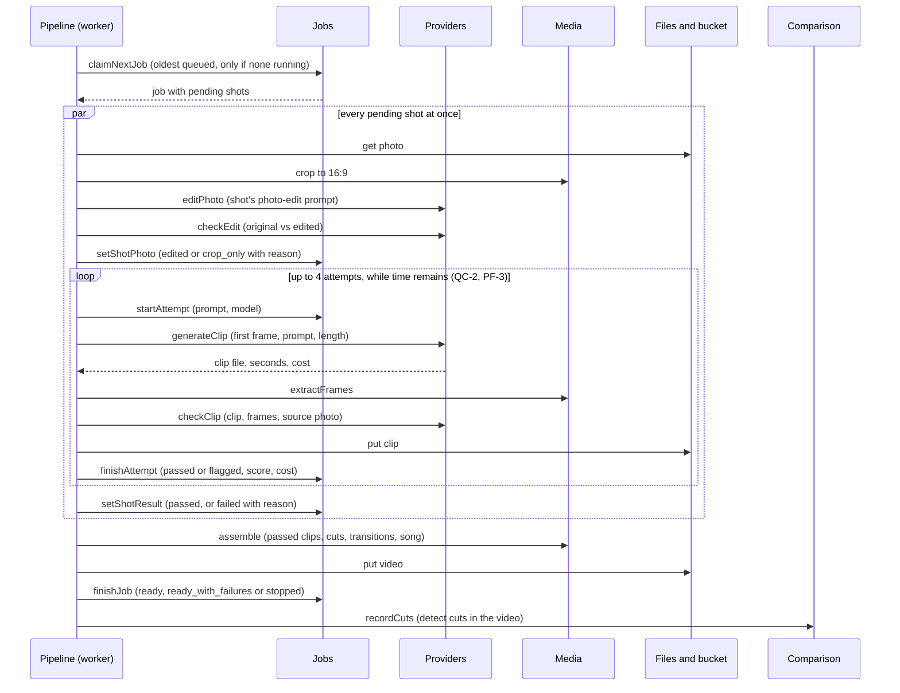
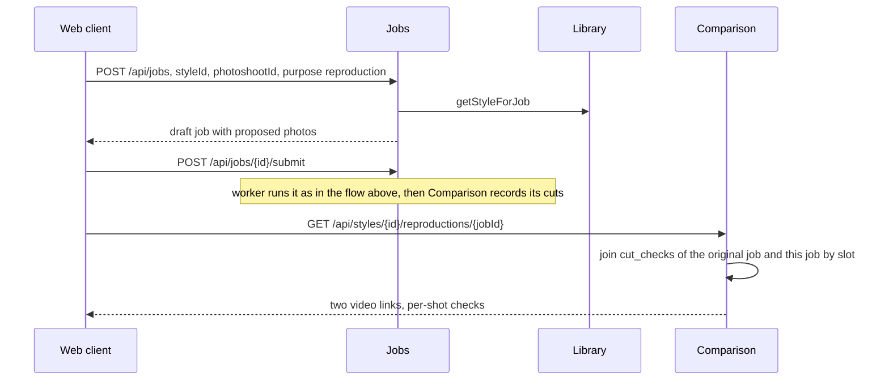
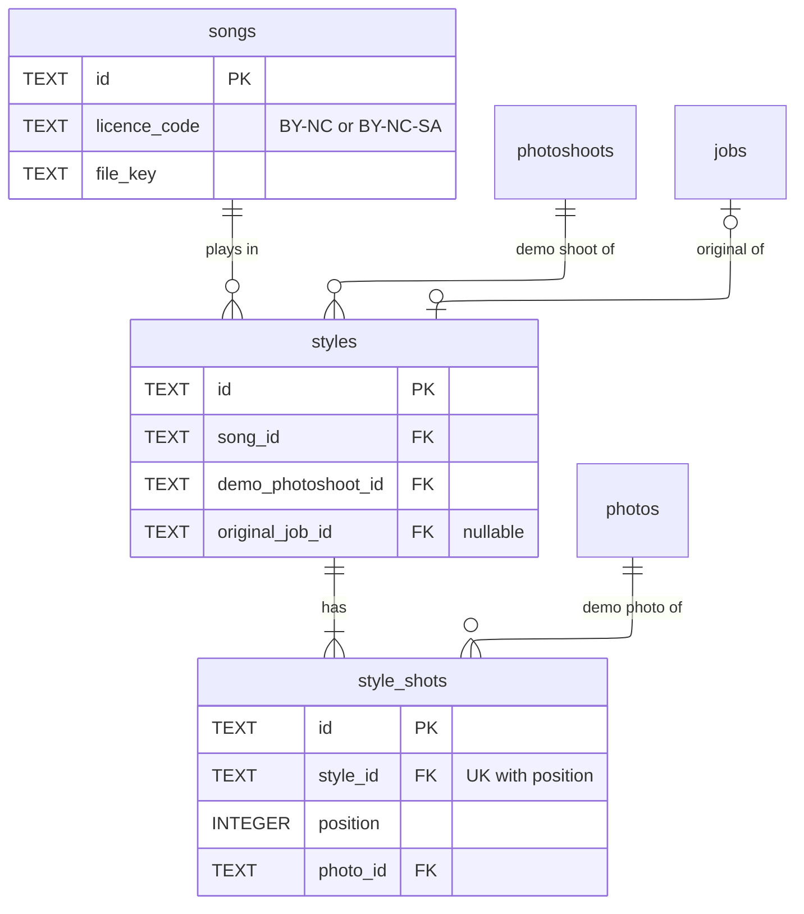
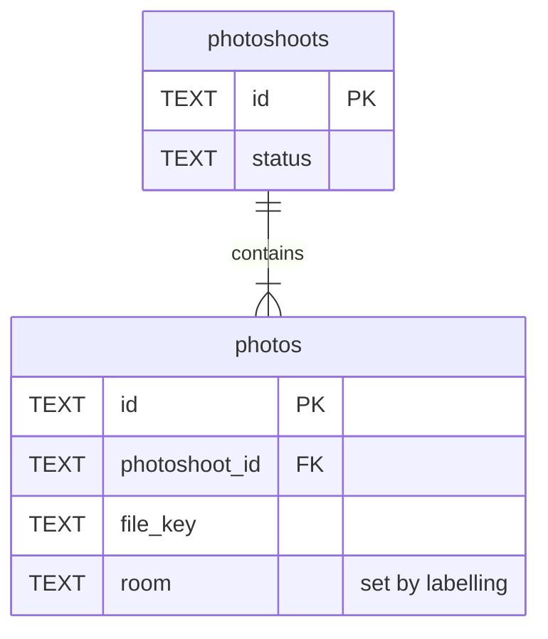
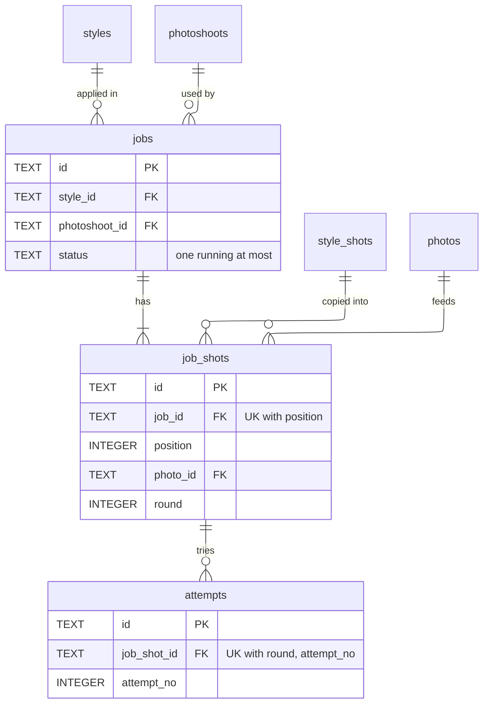

# ARCHITECTURE.md — AutoHDR Photo-to-Video

**What this document is.** The contracts between the parts of the system: the database schema, the API, the modules inside the app and the interface each surfaces, what goes to external services and storage, and how each interaction flows through them. Which boxes exist is `HIGH_LEVEL_DESIGN.md` (HLD); which technology fills each is `STACK.md`. How each module is built inside, and in what order, is left to the stories. Requirement IDs refer to `REQUIREMENTS.md`, metric names to `KEY_METRICS.md`. **[assumed]** marks a choice made without confirmation; each is listed under Assumptions.

## Summary

App server and background worker are two processes of one Python codebase in one container (STACK §3, §5). Modules marked *(worker)* run only in the worker process; *(both)* are libraries both processes call.



Every client route also passes through **Access** (the shared passphrase); those arrows are left off.

| Module | What it does | Owns (writes) | Serves | Called by |
|---|---|---|---|---|
| Access | Checks the shared demo passphrase on every request | none | every route | every route |
| Library | Songs, styles and their shots | `songs`, `styles`, `style_shots` | listStyles, getStyle, listSongs, createStyle, updateStyleShots | client; Jobs; Comparison |
| Photoshoots | Uploads and labels photos | `photoshoots`, `photos` | createUpload, completeUpload, getPhotoshoot | client; Jobs |
| Jobs | A job's life: draft, slot assignment, queue, shots, attempts, finished video | `jobs`, `job_shots`, `attempts` | createJob, updateJobShots, submitJob, restartJob, redoShot, listJobs, getJob, getVideo | client; Pipeline; Comparison; Evals |
| Pipeline *(worker)* | Runs the next queued job end to end | none | none (no caller) | worker loop |
| Providers *(both)* | Every call to an outside AI service, and its cost record | `provider_calls` | none | Pipeline; Photoshoots |
| Media *(both)* | Image and video processing (crop, frames, assemble, detect cuts) | none | none | Pipeline; Comparison |
| Files *(both)* | Bucket key layout, presigned links, object reads and writes | none (bucket objects) | none | Photoshoots; Jobs; Pipeline; Library |
| Comparison | Cut times detected in finished videos; original vs reproduction | `cut_checks` | getReproduction, setOriginal | client; Pipeline |
| Evals | Runs EV-1 and EV-2 and writes their reports | none (report files) | command line only | builder |

**Key decisions.**
- **One job runs at a time is a database rule:** a partial unique index allows at most one `jobs` row with status `running` (SC-1).
- **Only the Jobs module writes job state.** The worker's Pipeline owns no tables and changes jobs, shots and attempts only through Jobs' interface, so the app and worker never write the same rows two ways.
- **A job is a snapshot of its style.** `job_shots` copy the style shot's prompts, movement, length and transition at creation, so editing a style never changes a job that ran (CH-1, OB-1).
- **Restart, redo and first run are one path.** The worker runs every shot whose status is `pending`, then re-assembles the video. "Start again" and "Redo this shot" only set shots back to `pending` and queue the job (FR-1.5, FR-1.12).
- **A style's original video is a job.** The creator runs the style on its demo photoshoot and marks that job as the original. Reproductions are compared with it by detected cut times, so both sides are measured the same way (FR-2.4, VR-2) **[assumed]**.
- **Every outside call writes one `provider_calls` row**, with cost reported by OpenRouter or computed from the list price under BYOK (CO-1).

## Existing system

None. This is a greenfield build. `tools/gen_clip.py` is a research script whose request shape (base64 `frame_images` first frame, `generate_audio: false`, poll then download with the API key) is the reference for Providers → `generateClip`. It is not imported by the app.

HLD entity mapping: HLD *Video* is the `video_*` columns of `jobs` (one video per job). HLD *Song* = `songs`. All other HLD entities map one to one.

## Data flows

| Operation | Path | Sync / async | Committed before response? |
|---|---|---|---|
| listStyles | client → Library.listStyles → read `styles`, `songs`, count `style_shots` | sync | n/a (read) |
| getStyle | client → Library.getStyle → read `styles`, `style_shots`, `songs` | sync | n/a |
| listSongs | client → Library.listSongs → read `songs` | sync | n/a |
| createStyle | client → Library.createStyle → Photoshoots.listPhotos (validate) → insert `styles` + `style_shots` | sync | yes |
| updateStyleShots | client → Library.updateStyleShots → replace `style_shots` for the style | sync | yes |
| createUpload | client → Photoshoots.createUpload → insert `photoshoots`, `photos` (status `awaiting_upload`) → Files.presignUpload per photo → links | sync | yes |
| (browser upload) | client → bucket, one presigned POST per photo | sync, browser to bucket | n/a |
| completeUpload | client → Photoshoots.completeUpload → Files.headObject per photo → update `photos` → background: Providers.labelPhotos → update `photos.room` | sync accept, labels async | upload status yes, labels later |
| getPhotoshoot | client polls → read `photoshoots`, `photos` | sync | n/a |
| createJob | client → Jobs.createJob → Library.getStyleForJob → Photoshoots.listPhotos → insert `jobs` (draft) + `job_shots` with proposed photos | sync | yes |
| updateJobShots | client → Jobs.updateJobShots → update `job_shots.photo_id` (draft only) | sync | yes |
| submitJob | client → Jobs.submitJob → `jobs` draft → queued | sync | yes |
| listJobs, getJob | client polls every 5 s → read `jobs`, `job_shots`, latest `attempts` | sync | n/a |
| getVideo | client → Jobs.getVideo → Files.presignDownload | sync | n/a |
| restartJob | client → Jobs.restartJob → stopped job's unfinished shots → `pending`, job → queued | sync | yes |
| redoShot | client → Jobs.redoShot → one shot → `pending`, round + 1, job → queued | sync | yes |
| Run next job | worker loop → Jobs.claimNextJob → per pending shot in parallel: Media.crop, Providers.editPhoto + checkEdit, Providers.generateClip + checkClip, Jobs attempt updates → Media.assemble → Files.put → Jobs.finishJob → Comparison.recordCuts | async | each step committed as it happens |
| Startup recovery | worker start → Jobs.recoverInterrupted → `running` → `stopped` (reason `worker_restarted`) | async | yes |
| setOriginal | client → Comparison.setOriginal → Library.setOriginalJob → update `styles.original_job_id` | sync | yes |
| getReproduction | client → Comparison.getReproduction → read `cut_checks` for both jobs, `job_shots`, `attempts` | sync | n/a |
| Evals | builder runs command → Jobs.createJob + submitJob per shoot → waits → reads tables → writes report files | async, hours | n/a |

### Upload a photoshoot



### Make the video (the worker)



A provider error is written to the shot by `finishAttempt` as soon as it returns, so `getJob` shows it within one poll (RL-1). An out-of-credit answer stops the whole job (see Pipeline → Failure behaviour).

### Reproduce a style and compare



## Database schema

SQLite, one file, WAL mode, foreign keys on. Types are SQLite storage classes: ids are `TEXT` UUIDs made by the app, times are `TEXT` ISO-8601 in UTC, money is `REAL` US dollars, durations are `REAL` seconds. Value sets in check constraints may grow by a routine migration. "Owned by" means only that module's code writes the table; any module may read it.

### Library tables



#### `songs` — owned by Library

One Creative Commons track. Rows are added by a seed command, not through the UI.

| Column | Type | Null | Default | Meaning |
|---|---|---|---|---|
| id | TEXT | no | | UUID |
| title | TEXT | no | | Track title |
| artist | TEXT | no | | Artist name, shown in the credit line |
| licence_code | TEXT | no | | `BY-NC` or `BY-NC-SA` (GC-5) |
| source_url | TEXT | no | | Where the track was downloaded |
| file_key | TEXT | no | | Bucket key of the audio file |
| duration_s | REAL | no | | Track length |
| created_at | TEXT | no | now | |

- **Constraints:** check `licence_code in ('BY-NC','BY-NC-SA')`. ND licences are refused (GC-5, STACK §10).

#### `styles` — owned by Library

A saved storyboard plus its song.

| Column | Type | Null | Default | Meaning |
|---|---|---|---|---|
| id | TEXT | no | | UUID |
| name | TEXT | no | | Shown in the library |
| creator_name | TEXT | no | | Who made it; any name, since there are no accounts (FR-1.2) |
| song_id | TEXT → songs.id | no | | The style's song |
| song_offset_s | REAL | no | 0 | Where in the song the video starts |
| demo_photoshoot_id | TEXT → photoshoots.id | no | | The demo shoot the style was built on (FR-2.1) |
| original_job_id | TEXT → jobs.id | yes | null | The creator's approved run on the demo shoot; the "original video" (FR-2.4) |
| created_at, updated_at | TEXT | no | now | |

- **Constraints:** `name` unique.

#### `style_shots` — owned by Library

One shot slot of a style.

| Column | Type | Null | Default | Meaning |
|---|---|---|---|---|
| id | TEXT | no | | UUID |
| style_id | TEXT → styles.id | no | | |
| position | INTEGER | no | | Order in the video, from 1 |
| photo_id | TEXT → photos.id | no | | The demo-shoot photo the creator chose |
| room | TEXT | no | | What the slot shows: a `Room` value (Shared types); used to fill the slot on a new shoot (FR-1.10) |
| photo_edit_prompt | TEXT | yes | null | The edit toward composition, lens, angle and light (FR-1.8); null = crop only |
| movement_name | TEXT | no | | A `MovementName` (REQUIREMENTS Definitions) |
| movement_prompt | TEXT | no | | Movement prompt; starts as the PRD starter-kit text for `movement_name` and may be edited |
| speed | TEXT | no | `slow` | `slow`, `medium` or `fast` (more may be added) |
| model | TEXT | no | | Video model id, e.g. `google/veo-3.1` |
| length_s | REAL | no | | How long the shot plays in the video |
| transition | TEXT | no | `cut` | Transition into the next shot: `cut` or `crossfade` (more may be added) |
| transition_s | REAL | no | 0 | Crossfade length; 0 for a cut |

- **Constraints:** unique `(style_id, position)`; check `length_s > 0`; check `transition_s >= 0`; check `transition = 'cut' or transition_s > 0`.
- **Indexes:** `(style_id, position)`, from the unique constraint: getStyle reads shots in order.

### Photoshoots tables



#### `photoshoots` — owned by Photoshoots

| Column | Type | Null | Default | Meaning |
|---|---|---|---|---|
| id | TEXT | no | | UUID |
| label | TEXT | yes | null | Optional name, e.g. the property address |
| status | TEXT | no | `awaiting_upload` | `awaiting_upload`, `labelling`, `ready`, `label_failed` (more may be added) |
| created_at | TEXT | no | now | |

#### `photos` — owned by Photoshoots

| Column | Type | Null | Default | Meaning |
|---|---|---|---|---|
| id | TEXT | no | | UUID |
| photoshoot_id | TEXT → photoshoots.id | no | | |
| position | INTEGER | no | | Upload order, from 1 |
| original_name | TEXT | no | | File name as uploaded |
| content_type | TEXT | no | | `image/jpeg` or `image/png` (DE-2) |
| size_bytes | INTEGER | no | | Declared size; checked again by the bucket |
| file_key | TEXT | no | | Bucket key |
| status | TEXT | no | `awaiting_upload` | `awaiting_upload`, `uploaded`, `missing` |
| width, height | INTEGER | yes | null | Read after upload |
| room | TEXT | yes | null | `Room` value from labelling |
| subject | TEXT | yes | null | Short description from labelling, e.g. "kitchen island with pendants" |

- **Constraints:** unique `(photoshoot_id, position)`; check `size_bytes <= 26214400` (25 MB, DE-2); check `content_type in ('image/jpeg','image/png')`.

### Jobs tables



#### `jobs` — owned by Jobs

One run of photoshoot + style → video. The video's own columns are here (HLD *Video*).

| Column | Type | Null | Default | Meaning |
|---|---|---|---|---|
| id | TEXT | no | | UUID |
| style_id | TEXT → styles.id | no | | |
| photoshoot_id | TEXT → photoshoots.id | no | | |
| purpose | TEXT | no | `video` | `video` or `reproduction` (FR-2.3) |
| status | TEXT | no | `draft` | `JobStatus` (Shared types) |
| stop_reason | TEXT | yes | null | `StopReason` when status is `stopped` |
| song_id | TEXT → songs.id | no | | Copied from the style at creation |
| song_offset_s | REAL | no | | Copied from the style |
| created_at | TEXT | no | now | |
| submitted_at | TEXT | yes | null | Set by submit, restart and redo; PF-1 is timed from here |
| deadline_at | TEXT | yes | null | `submitted_at` + 30 min (PF-1, PF-3) |
| started_at | TEXT | yes | null | When the worker claimed it |
| finished_at | TEXT | yes | null | When it reached `ready`, `ready_with_failures` or `stopped` |
| video_key | TEXT | yes | null | Bucket key of the finished video |
| video_duration_s | REAL | yes | null | |
| video_width, video_height | INTEGER | yes | null | 1920 × 1080 (DE-5) |
| video_fps | REAL | yes | null | |
| total_cost_usd | REAL | no | 0 | Sum of this job's `provider_calls.cost_usd` (CO-1) |

- **Constraints:** check status in the `JobStatus` set; check `status <> 'stopped' or stop_reason is not null`.
- **Indexes:** unique partial index on `(status) where status = 'running'`: at most one running job (SC-1). `(status, submitted_at)`: the worker picks the oldest queued job. `(created_at desc)`: listJobs.

#### `job_shots` — owned by Jobs

One shot of a job, with a copy of its style shot.

| Column | Type | Null | Default | Meaning |
|---|---|---|---|---|
| id | TEXT | no | | UUID |
| job_id | TEXT → jobs.id | no | | |
| style_shot_id | TEXT → style_shots.id | no | | |
| position | INTEGER | no | | Copied |
| room, photo_edit_prompt, movement_name, movement_prompt, speed, model, length_s, transition, transition_s | as in `style_shots` | | | Copied at createJob, never changed afterwards |
| photo_id | TEXT → photos.id | yes | null | The photo filling the slot; null = slot skipped (FR-1.10) |
| assignment_note | TEXT | yes | null | Why: `matched`, `reused` (photo also used by another slot) or `no_match` |
| status | TEXT | no | `pending` | `ShotStatus` (Shared types) |
| status_detail | TEXT | yes | null | What the photographer reads, e.g. "Attempt 2 of 4: flagged, a person appears" |
| failure_reason | TEXT | yes | null | `FailureReason` when status is `failed` |
| round | INTEGER | no | 0 | 0 on the first run; +1 on each redo or restart |
| cropped_key | TEXT | yes | null | Bucket key of the 16:9 crop |
| edited_key | TEXT | yes | null | Bucket key of the edited photo used as first frame |
| edit_status | TEXT | yes | null | `edited` or `crop_only` |
| edit_note | TEXT | yes | null | Why the edit was not used, if `crop_only` |
| final_attempt_id | TEXT → attempts.id | yes | null | The attempt whose clip is in the video |
| updated_at | TEXT | no | now | Changes whenever status or detail changes; RL-1 is measured from it |

- **Constraints:** unique `(job_id, position)`; check status in the `ShotStatus` set; check `status <> 'failed' or failure_reason is not null`.

#### `attempts` — owned by Jobs

One try at making a shot's clip.

| Column | Type | Null | Default | Meaning |
|---|---|---|---|---|
| id | TEXT | no | | UUID |
| job_shot_id | TEXT → job_shots.id | no | | |
| round | INTEGER | no | | The shot's round when this attempt ran |
| attempt_no | INTEGER | no | | 1 to 4: the first try plus up to 3 regenerations (QC-2) |
| prompt | TEXT | no | | The exact prompt sent (OB-1) |
| model | TEXT | no | | Model id actually used |
| requested_s | REAL | no | | Clip length requested |
| status | TEXT | no | `running` | `running`, `passed`, `flagged`, `error` |
| clip_key | TEXT | yes | null | Bucket key of the clip |
| check_ai_score | REAL | yes | null | 0–1, higher = looks more AI-generated (OB-2) |
| check_match_score | REAL | yes | null | 0–1, higher = closer to the source photo |
| check_notes | TEXT | yes | null | What the check saw, e.g. "a person appears in the mirror" |
| error | TEXT | yes | null | Provider error kind and message when status is `error` |
| cost_usd | REAL | no | 0 | Cost of the clip and its check |
| started_at, finished_at | TEXT | | | |

- **Constraints:** unique `(job_shot_id, round, attempt_no)`; check `attempt_no between 1 and 4`.

### Providers table

#### `provider_calls` — owned by Providers

One row per call to an outside AI service (CO-1).

| Column | Type | Null | Default | Meaning |
|---|---|---|---|---|
| id | TEXT | no | | UUID |
| kind | TEXT | no | | `label_photos`, `edit_photo`, `check_edit`, `generate_clip`, `check_clip` (more may be added) |
| model | TEXT | no | | Model id |
| job_id | TEXT → jobs.id | yes | null | Null for labelling, which happens before a job exists |
| job_shot_id | TEXT → job_shots.id | yes | null | |
| attempt_id | TEXT → attempts.id | yes | null | |
| photoshoot_id | TEXT → photoshoots.id | yes | null | For labelling |
| provider_request_id | TEXT | yes | null | OpenRouter's id for the request or video job |
| status | TEXT | no | `running` | `ok` or `error` (or `running` while in flight) |
| error_kind | TEXT | yes | null | `ProviderErrorKind` |
| error_message | TEXT | yes | null | First 500 characters |
| output_seconds | REAL | yes | null | Seconds of video returned, for clip calls |
| cost_usd | REAL | no | 0 | Cost in US dollars |
| cost_source | TEXT | no | `reported` | `reported` (from OpenRouter's response) or `list_price` (BYOK, seconds × listed price) |
| started_at, finished_at | TEXT | | | |

- **Indexes:** `(job_id)`: job totals and EV reports.

### Comparison table

#### `cut_checks` — owned by Comparison

The cut times detected in one finished video, one row per shot boundary.

| Column | Type | Null | Default | Meaning |
|---|---|---|---|---|
| job_id | TEXT → jobs.id | no | | |
| boundary_no | INTEGER | no | | 1 = the cut between shots 1 and 2 |
| expected_s | REAL | no | | Where the style puts the cut (sum of `length_s` so far) |
| detected_s | REAL | yes | null | Where the cut detector found it; null if not found |
| error_s | REAL | yes | null | `detected_s − expected_s` |
| transition | TEXT | no | | Copied from the shot, so crossfade misses are read correctly |
| checked_at | TEXT | no | now | |

- **Constraints:** primary key `(job_id, boundary_no)`. Re-running the check replaces the job's rows.

## Shared types

Types that cross more than one boundary.

```
JobStatus   draft | queued | running | ready | ready_with_failures | stopped   (more may be added)
ShotStatus  pending | editing | generating | checking | passed | failed | skipped   (more may be added)
StopReason  out_of_credit | worker_restarted | assembly_failed | out_of_time   (more may be added)
FailureReason
            flagged_every_attempt   all attempts failed the check (QC-2)
            provider_error          the provider returned an error on the last attempt
            refused                 the provider refused the content
            out_of_time             no time left before deadline_at (PF-3)
            no_photo                the slot was skipped (FR-1.10)
            (more may be added)
ProviderErrorKind
            rate_limited | out_of_credit | refused | failed | timeout | bad_response   (more may be added)

Room        exterior_front | exterior_back | living | kitchen | dining | bedroom |
            bathroom | office | hallway | detail | aerial | other   (more may be added)

MovementName  the 12 PRD starter-kit names in REQUIREMENTS Definitions, stored as
              snake_case codes: dolly_in, dolly_in_timelapse, drone_top_down_descend,
              timelapse_variant, dolly_out, slider_truck_left_to_right,
              slider_truck_right_to_left, parallax_orbit, dolly_in_pan_right,
              crane_up, crane_down, orbit_hyperlapse   (more may be added)

Song {
  id, title, artist, licenceCode, sourceUrl
  durationS      track length
  credit         "title, artist, licence, source URL", shown with every video (GC-5)
}

StyleShot {
  id, position, photoId, room
  photoEditPrompt   null = crop only
  movementName, movementPrompt, speed, model
  lengthS, transition, transitionS
}

Style {
  id, name, creatorName
  song             Song
  songOffsetS
  demoPhotoshootId
  originalJobId    null until the creator marks one
  shots            StyleShot[] in position order
}

Photo {
  id, position, originalName, contentType, sizeBytes
  status        awaiting_upload | uploaded | missing
  room, subject null until labelled
  thumbUrl      presigned download link, 1 h
}

JobShot {
  id, position, room, movementName, lengthS, transition
  photoId          null = skipped
  assignmentNote   matched | reused | no_match
  status           ShotStatus
  statusDetail     text for the photographer
  failureReason    FailureReason or null
  attempts         number of attempts in the current round
  clipUrl          presigned link to the final clip, when passed
}

Job {
  id, styleId, styleName, photoshootId, purpose
  status       JobStatus
  stopReason   StopReason or null
  submittedAt, startedAt, finishedAt
  elapsedS     now − submittedAt while running, finishedAt − submittedAt after
  totalCostUsd
  waitingBehind  id of the running job when this one is queued, else null (SC-1)
  shots        JobShot[]
  video        { url, durationS, width, height } or null
  songCredit   Song.credit
}

ClipResult {
  path, seconds, model
  costUsd, costSource   reported | list_price
  providerRequestId
}

ClipCheck {
  aiScore       0–1
  matchScore    0–1
  peopleCount   people seen in the clip that are not in the photo
  addedObjects  text list of things not in the photo
  passed        aiScore and matchScore within the configured thresholds and nothing added
  notes         short text for status_detail
}

EditCheck {
  architectureChanged  true if a wall, window, door, fixture or room feature was added, removed or moved (VR-5)
  notes
}

ProviderError { kind: ProviderErrorKind, message, retryAfterS or null }
```

## Module: Access — the shared passphrase

### What it does
Lets a request through only if it carries the demo passphrase (FR-3.2, STACK §11).

### Owns
Nothing.

### API
No routes of its own. It wraps every route except `GET /healthz`.

```
Every route
Caller     anyone with the passphrase
Request    HTTP basic auth, any user name, password = DEMO_PASSPHRASE
Errors     401 with a basic-auth challenge, no body detail
```

### Must hold
- No route other than `/healthz` answers without the passphrase.
- The passphrase is never logged.

## Module: Library — songs and styles

### What it does
Holds the songs and the styles, and gives each new job a consistent copy of its style.

### Owns
Writes `songs` (seed command only), `styles`, `style_shots`. Reads `photos` through Photoshoots.

### API

Pages under `/` render the same data as these JSON routes by calling the same module functions; the contract is the same with or without HTTP. This holds for every module.

```
listStyles   GET /api/styles                           serves FR-1.2, HLD I-1
Response   200 { styles: [{ id, name, creatorName, song: Song, shotCount, hasOriginal }] }

getStyle     GET /api/styles/{id}                      serves HLD I-1, I-9
Response   200 { style: Style }
Errors     404 style_not_found

listSongs    GET /api/songs                            serves FR-2.1, GC-5
Response   200 { songs: Song[] }

createStyle  POST /api/styles                          serves FR-2.1, FR-2.2, HLD I-8
Request    { name, creatorName, songId, songOffsetS?, demoPhotoshootId,
             shots: [ StyleShot without id ] }
Response   201 { style: Style }
Errors     400 invalid_shots — names each bad row and why (unknown movement, photo
               not in the demo shoot, length longer than the model's longest clip)
           404 song_not_found | photoshoot_not_found
           409 name_taken
           (more may be added)

updateStyleShots  PUT /api/styles/{id}/shots           serves FR-2.1, HLD I-8
Request    { shots: [ StyleShot without id ], songId?, songOffsetS? }
Response   200 { style: Style }
Errors     400 invalid_shots, 404 style_not_found
```

### Interface for other modules
```
getStyleForJob(styleId) -> Style
  The style with its shots in order. Throws StyleNotFound, StyleHasNoShots.
  Callers rely on: the returned shots are one consistent read, never a mix of
  before and after an update.

setOriginalJob(styleId, jobId)
  Records the style's original video. Called only by Comparison.setOriginal.
```

### Calls out
Photoshoots.listPhotos to check that each shot's photo belongs to the demo shoot. Providers.allowedLengths(model) to check `length_s` fits the model.

### Must hold
- Only Library writes `songs`, `styles`, `style_shots`.
- A style shot's `length_s` plus its `transition_s` fits within the longest clip its model can make.
- Every song a style uses has a licence of BY-NC or BY-NC-SA (GC-5).
- Updating a style never changes a job that already exists (jobs hold copies).

## Module: Photoshoots — uploads and labels

### What it does
Accepts a photoshoot's photos straight into the bucket and labels each photo's room so a style's shot slots can be filled (FR-1.1, FR-1.10).

### Owns
Writes `photoshoots`, `photos`.

### API
```
createUpload   POST /api/photoshoots                    serves FR-1.1, DE-2, HLD I-2
Request    { label?, files: [{ name, size, type }] }
Response   201 { photoshootId,
                 uploads: [{ photoId, name, url, fields }],   presigned POST, 15 min
                 refused: [{ name, reason }] }              reason: wrong_type | too_large
Errors     400 too_many_files — more than 40 (DE-2)
           400 no_valid_files
           (more may be added)

completeUpload  POST /api/photoshoots/{id}/complete      serves FR-1.1
Response   202 { photoshoot: { id, status, photos: Photo[] } }
           photos the bucket does not hold are marked missing; labelling starts
Errors     404 photoshoot_not_found

getPhotoshoot   GET /api/photoshoots/{id}                serves FR-1.10 (poll for labels)
Response   200 { photoshoot: { id, label, status, photos: Photo[] } }
Errors     404 photoshoot_not_found
```

### Jobs and messages
```
labelPhotoshoot   started by completeUpload, runs in the app process in the background
Reads          photos (uploaded)
Writes         photos.room, photos.subject; photoshoots.status labelling → ready | label_failed
Twice-safe     yes — labels are overwritten
On failure     status label_failed; createJob still works and every slot is
               assigned in upload order with assignment_note no_match
```

### Interface for other modules
```
listPhotos(photoshootId) -> Photo[]
  Uploaded photos only, in upload order, with room and subject if labelled.
  Throws PhotoshootNotFound.
```

### Calls out
- Files.presignUpload(key, contentType, maxBytes) for each photo, and Files.headObject to confirm uploads.
- Providers.labelPhotos(photos) with small copies (long side ≤ 768 px) of every uploaded photo.

### Must hold
- No photo over 25 MB or of another type reaches the bucket: the presigned form itself limits size and type, not only the page (DE-2).
- A photo's `file_key` never changes after creation.
- Photos are never written to the repository (GC-9).

## Module: Jobs — the life of a job

### What it does
Creates a job from a style and a photoshoot, proposes which photo fills each slot, queues it, and holds every shot's and attempt's state for the page and the worker.

### Owns
Writes `jobs`, `job_shots`, `attempts`. Reads `styles`, `style_shots` (through Library), `photos` (through Photoshoots), `provider_calls`.

### API
```
createJob    POST /api/jobs                            serves FR-1.10, FR-2.3, FR-2.5, HLD I-3, I-11
Request    { styleId, photoshootId, purpose?: video | reproduction }
Response   201 { job: Job }   status draft, each slot with a proposed photo
Errors     404 style_not_found | photoshoot_not_found
           409 photoshoot_not_ready — still uploading (labelling may still run;
               slots are then filled in upload order)
           (more may be added)

updateJobShots  PUT /api/jobs/{id}/shots               serves FR-1.10, HLD I-11
Request    { shots: [{ position, photoId | null }] }
Response   200 { job: Job }
Errors     404 job_not_found
           409 not_draft
           400 photo_not_in_photoshoot

submitJob    POST /api/jobs/{id}/submit                serves FR-1.3, SC-1, HLD I-3
Response   202 { job: Job }   queued; waitingBehind set if another job runs
Errors     404 job_not_found, 409 not_draft, 409 no_shots_to_make

restartJob   POST /api/jobs/{id}/restart               serves FR-1.5
Response   202 { job: Job }   unfinished shots pending again, finished shots kept
Errors     404 job_not_found, 409 not_stopped

redoShot     POST /api/jobs/{id}/shots/{position}/redo serves FR-1.12, HLD I-12
Response   202 { job: Job }
Errors     404 job_not_found | shot_not_found
           409 job_busy — job is queued or running
           409 no_photo — the slot is skipped

listJobs     GET /api/jobs                             serves FR-1.11, HLD I-6
Response   200 { jobs: [{ id, styleName, photoshootLabel, purpose, status, submittedAt, elapsedS }] }
           newest first

getJob       GET /api/jobs/{id}                        serves FR-1.3, FR-1.5, RL-1, HLD I-5
Response   200 { job: Job }
Errors     404 job_not_found

getVideo     GET /api/jobs/{id}/video                  serves FR-1.9, HLD I-7
Response   200 { url, downloadUrl, durationS }   url plays inline, downloadUrl saves the file, 1 h
Errors     404 job_not_found, 409 no_video
```

### Interface for other modules
```
claimNextJob() -> Job | None
  Moves the oldest queued job to running, only if no job is running, and returns it
  with its pending shots. None when there is nothing to do.
  Callers rely on: two callers can never both get a job (unique running index).

recoverInterrupted()
  Called once when the worker starts. Every running job → stopped, stop_reason
  worker_restarted; its in-flight shots → pending so "Start again" resumes them.

setShotState(jobShotId, status, detail)
setShotPhoto(jobShotId, croppedKey, editedKey | None, editStatus, editNote)
startAttempt(jobShotId, prompt, model, requestedS) -> attemptId
  Throws AttemptLimitReached after attempt 4 of the shot's current round (QC-2).
finishAttempt(attemptId, status, clipKey?, check?: ClipCheck, error?: ProviderError, costUsd)
setShotResult(jobShotId, passed | failed, failureReason?, finalAttemptId?)
finishJob(jobId, status, stopReason?, video?: { key, durationS, width, height, fps })
  Also totals provider_calls.cost_usd into total_cost_usd.
stopJob(jobId, stopReason)
  Marks every pending or in-flight shot failed with a reason and the job stopped.

createJob / submitJob as in the API, for Evals.
```
Every function is one short transaction, safe to call from several worker threads at once.

### Must hold
- Only Jobs writes `jobs`, `job_shots`, `attempts`.
- At most one job is `running` (unique partial index, SC-1).
- A job's copied shot fields never change after creation (CH-1).
- `attempt_no` never exceeds 4 per shot per round (QC-2).
- A shot never moves to `failed` without a `failure_reason`, and a failed shot is always listed in `getJob` (RL-2).
- A job never reaches `ready` with a shot still `pending` or in flight.
- `getJob` returns only the final passed clip of a shot, never a flagged attempt's clip (FR-1.7).

### Failure behaviour
| Failure | What the caller / user sees | What is recorded |
|---|---|---|
| Submit while another job runs | Job page says "Waiting for job {n} to finish" | status queued, waitingBehind |
| Worker restarted mid-job | Job stopped, reason "the worker restarted", "Start again" | stop_reason worker_restarted |

## Module: Pipeline — runs a job (worker)

### What it does
Polls Jobs for the next queued job, makes every pending shot at once, and cuts the passing clips to the song (FR-1.4–FR-1.8, PF-1).

### Owns
Nothing. All writes go through Jobs, Comparison and Files.

### Jobs and messages
```
runNextJob   worker loop, polls Jobs.claimNextJob every few seconds   serves HLD I-4, I-12
Trigger proof  none needed — the worker process takes no outside input
Reads          the claimed job, its shots, photos, song
Writes         through Jobs: shot states, attempts, final job state; through Files: crops,
               edited photos, clips, video; through Comparison: cut checks
Twice-safe     a job is claimed once (unique running index); a restarted job re-runs only
               shots that are pending
On failure     see Failure behaviour; nothing is retried after deadline_at
```

What it does per pending shot, as the contract other modules see it:
1. Crop the photo to 16:9 (Media). If the shot has a photo-edit prompt, edit it (Providers.editPhoto), check it against the crop (Providers.checkEdit), retry the edit once if architecture changed, then fall back to the crop with `edit_status = crop_only` and a note (FR-1.8, VR-5).
2. Build the prompt: the shot's movement prompt, its speed, and a fixed lock text ("same room, no new objects, no people, no reflections of people or cameras", from `VIDEO_RESEARCH.md` §7.3). The full prompt is stored on the attempt (OB-1).
3. Request a clip of the shortest length the model allows that covers `length_s + transition_s` (STACK §6).
4. Check the clip (Providers.checkClip with frames at 4–8 per second from Media). Passed → shot passed. Flagged → next attempt, up to 4 per round, while `deadline_at` leaves time for one more clip and check.
5. Shots run in parallel; the number in flight is a setting.

Then assemble: passed clips in position order, each trimmed to `length_s`, joined with the shot's transition, re-encoded at 1920 × 1080, 16:9, over the song from `song_offset_s` (DE-5, VR-2). A failed or skipped shot leaves its slot out and the video is marked `ready_with_failures` (FR-1.6). If no shot passed, the job is `stopped` with every reason shown.

### Calls out
Jobs (interface above), Providers, Media, Files, Comparison.recordCuts.

### Must hold
- A shot's clip is used only if its check passed (FR-1.7).
- One shot failing never stops the other shots (RL-3).
- Every provider error reaches the shot's `status_detail` within 60 s of the provider answering (RL-1).
- No clip is requested after `deadline_at` (PF-1, PF-3).
- Temporary files live on the container's disk, never on the volume (STACK §5).

### Failure behaviour
| Failure | What the user sees | What is recorded |
|---|---|---|
| Rate limited (429) or timeout on one clip | Shot detail "Provider busy, trying again"; the attempt counts | attempt error, provider_calls error_kind |
| Provider refuses the content | Shot failed: "The video service refused this photo" | failure_reason refused |
| Out of credit (402) | Job stopped: "The video service account is out of credit." Finished shots kept | stop_reason out_of_credit |
| All 4 attempts flagged | Shot failed: the last check's notes | failure_reason flagged_every_attempt |
| Deadline reached | Unfinished shots failed: "Ran out of time" | failure_reason out_of_time |
| Assembly fails | Job stopped: "Could not cut the video"; clips kept | stop_reason assembly_failed |

## Module: Providers — outside AI services

### What it does
Makes every call to OpenRouter, turns errors into one set of kinds, and writes a cost row for each call.

### Owns
Writes `provider_calls`.

### Interface for other modules
```
labelPhotos(photos: [{ photoId, jpegBytes }], photoshootId) -> [{ photoId, room: Room, subject }]
editPhoto(jpegBytes, prompt, ids) -> jpegBytes
checkEdit(originalJpeg, editedJpeg, ids) -> EditCheck
generateClip(firstFrameJpeg, prompt, model, lengthS, ids) -> ClipResult
  Submits, polls and downloads. Raises ProviderError.
checkClip(clipPath, frames: jpegBytes[], sourceJpeg, ids) -> ClipCheck
allowedLengths(model) -> number[]
  Clip lengths the model accepts, read from OpenRouter's model list and cached.

ids = { jobId?, jobShotId?, attemptId?, photoshootId? }, copied into provider_calls.
All raise ProviderError { kind, message, retryAfterS }.
Callers rely on: every call, ok or not, leaves exactly one provider_calls row with a
cost; a call never retries on its own after a 402.
```

### Calls out

| Call | Endpoint and model (from configuration) | Sent | Returned |
|---|---|---|---|
| generateClip | OpenRouter Videos API; `VIDEO_MODEL` default `google/veo-3.1`, fallback `bytedance/seedance-2.0`; the shot's `model` wins | model, prompt, duration, resolution 1080p, aspect ratio 16:9, audio off, the photo as a base64 first frame | job id → poll → clip file, downloaded with the API key; cost in `usage` |
| editPhoto | OpenRouter chat completions; `ENHANCE_MODEL` default `google/gemini-nano-banana-2.1` | the cropped photo, the shot's photo-edit prompt ending "preserve all architectural and interior details" (PRD pp.10–12) | one image |
| checkEdit, checkClip, labelPhotos | OpenRouter chat completions; `QUALITY_CHECK_MODEL` default `google/gemini-3.8-flash` | photos as images; for clips, the clip inline plus frames, both small enough for the inline limit | JSON matching EditCheck, ClipCheck or labels; anything else → `bad_response` |

- **Cost:** `cost_usd` is the cost OpenRouter reports. When the response marks the call as BYOK, `cost_usd` = output seconds × the model's listed price per second and `cost_source = list_price` (CO-1).
- **Errors:** 429 → `rate_limited` (with Retry-After), 402 → `out_of_credit`, a moderation or content refusal → `refused`, 5xx or a failed job → `failed`, no answer within the call's time limit → `timeout`.
- **Test double:** `FakeProviders`, selected by `FAKE_PROVIDERS=1`. It returns a fixed image, a short generated test clip and scripted checks, and can be told to raise any `ProviderErrorKind` on a chosen call (RL-1–RL-3 tests). It writes `provider_calls` rows like the real one, with cost 0.

### Must hold
- The API key appears only in the request header, never in a log, a row or an error message.
- No clip is left undownloaded at OpenRouter once its job completes.

## Module: Media — image and video processing

### What it does
Local processing with Pillow, ffmpeg and PySceneDetect. No outside calls, no tables.

### Interface for other modules
```
crop16x9(imageBytes) -> jpegBytes        centre crop to 16:9, long side ≤ 1920 px
thumbnail(imageBytes, longSide) -> jpegBytes
extractFrames(clipPath, perSecond) -> jpegBytes[]
probe(videoPath) -> { durationS, fps, width, height }
assemble(clips: [{ path, lengthS, transition, transitionS }], songPath, songOffsetS,
         outPath, width, height, fps) -> { durationS }
  Re-encodes; every cut lands within one frame of the sum of lengths (VR-2).
detectCuts(videoPath) -> seconds[]
```
Raises MediaError with the tool's message.

### Must hold
- Cuts are re-encoded, never stream-copied, so they land on the requested frame (STACK §9).

## Module: Files — bucket objects

### What it does
Owns the key layout and every presigned link.

### Calls out
| Key | What | Written by |
|---|---|---|
| `photoshoots/{photoshootId}/{photoId}.{jpg|png}` | Uploaded photo | the browser, through a presigned POST |
| `jobs/{jobId}/shots/{position}/r{round}/cropped.jpg`, `edited.jpg` | Prepared first frames | Pipeline |
| `jobs/{jobId}/shots/{position}/r{round}/a{attemptNo}.mp4` | Every attempt's clip | Pipeline |
| `jobs/{jobId}/video.mp4` | Finished video | Pipeline |
| `songs/{songId}.{ext}` | Song audio | seed command |

```
presignUpload(key, contentType, maxBytes) -> { url, fields }   15 min, size range 1..maxBytes
presignDownload(key, asAttachment, filename?) -> url             1 h
put(key, path) / get(key, path) / headObject(key) -> { sizeBytes } | None
```
- **Test double:** moto's S3 in tests (STACK §14).

### Must hold
- The bucket is private; every browser read or write goes through a presigned link.
- Presigned links are never logged.

## Module: Comparison — cut times and side by side

### What it does
Measures where the cuts landed in each finished video, and lays a reproduction beside its style's original (FR-2.4, VR-2).

### Owns
Writes `cut_checks`. Reads `jobs`, `job_shots`, `attempts`, `styles`.

### API
```
setOriginal    POST /api/styles/{id}/original           serves FR-2.4
Request    { jobId }
Response   200 { style: Style }
Errors     404 style_not_found | job_not_found
           409 not_eligible — the job is not ready, or not this style on its demo shoot

getReproduction  GET /api/styles/{id}/reproductions/{jobId}   serves FR-2.4, VR-2, VR-6, HLD I-9
Response   200 {
  original:     { jobId, videoUrl } ,
  reproduction: { jobId, videoUrl, photoshootLabel, sameHouse: bool },
  song:         { sameSong: bool, credit },
  shots: [{ position, movementName, transition,
            originalCutS, reproductionCutS, cutErrorS,      null for the last shot
            flagged: bool }],                               reproduction's shot failed or flagged
  maxCutErrorS
}
Errors     404 style_not_found | job_not_found
           409 no_original — the style has no original yet
           409 not_ready
```

### Interface for other modules
```
recordCuts(jobId)
  Detects cuts in the job's video and replaces its cut_checks rows. Called by Pipeline
  after finishJob. Failure is recorded on the row (detected_s null), never fails the job.
```

### Must hold
- Only Comparison writes `cut_checks`.
- An original is always a ready job of the same style on its demo shoot.

## Module: Evals — EV-1 and EV-2 (command line)

### What it does
Runs the evaluation jobs and writes their reports for the reviewer.

### Owns
No tables. Writes report files under `evals/` in the repo (text and numbers only, no photos, GC-9).

### Jobs and messages
```
evals run --suite ev1 | ev2 --style {name}       run by the builder
Writes         jobs through Jobs.createJob + submitJob (one at a time, the queue does the rest);
               then evals/{suite}-{date}.md and a reviewer sheet evals/{suite}-{date}-review.csv
               with one row per shot: visibly_ai, room_changed, movement_matches, transition_matches
evals report --sheet {csv}
Reads          the filled sheet, jobs, attempts, cut_checks
Writes         the final report: per video, visibly AI shots (VR-1), rooms changed (VR-5),
               cut error (VR-2), job time (PF-1); per style and shoot VR-2, VR-3, VR-4, VR-6;
               and how many reviewer-failed shots the check flagged (QC-1)
Twice-safe     yes — a run creates new jobs; reports are new files
On failure     a job that stops is reported with its reason; the run continues
```

## System-wide contracts

| Contract | Rule |
|---|---|
| Error format | Every JSON route returns `{ "error": code, "message": text }` with a snake_case code; pages show the message in place |
| Times | Stored in UTC as ISO-8601 text; shown in the browser's local time |
| Database | Foreign keys on and a busy timeout of several seconds on every connection; writes are short transactions (STACK §3) |
| Scrubbing | Logs never contain the API key, the passphrase, presigned URLs or image or video data |
| Backup and restore | None required (HLD §1 row 3). The demo job's video is also downloaded and kept offline before the demo (DE-4) |
| Health | `GET /healthz` returns 200 if the database opens; no passphrase needed |
| Processes | One container runs the app and the worker; if either exits, both stop so the host restarts the container (STACK §5) |
| Configuration | Environment variables only: `OPENROUTER_API_KEY`, `OPENROUTER_BASE_URL`, `VIDEO_MODEL`, `VIDEO_MODEL_FALLBACK`, `ENHANCE_MODEL`, `QUALITY_CHECK_MODEL`, bucket credentials and name, `DATABASE_PATH`, `DEMO_PASSPHRASE`, `FAKE_PROVIDERS`, check thresholds, shots in flight. `.env.example` lists them |

## Measurement

| Metric (KEY_METRICS.md) | Data source | Added by this document? |
|---|---|---|
| Video wait time, slowest and typical (PF-1, PF-2) | `jobs.finished_at − jobs.submitted_at` | yes |
| Time to tell the user about a provider error (RL-1) | `provider_calls.finished_at` (error) to `job_shots.updated_at` of the matching shot | yes |
| Regeneration attempts per shot (QC-2) | count of `attempts` per shot and round | yes |
| Delivered shots the check still flags (VR-1 proxy) | `attempts.status` of each `job_shots.final_attempt_id` | yes |
| Cut-time error against the style (VR-2) | `cut_checks.error_s` | yes |
| Cost per call and per job (CO-1) | `provider_calls.cost_usd`, `jobs.total_cost_usd` | yes |
| Reviewer checks (VR-1, VR-3–VR-6, QC-1 catch rate) | Evals reviewer sheet | yes, report files |

## Environments and the regression gate

| Environment | What it connects to | Notes |
|---|---|---|
| Local | SQLite file on disk, dev bucket, OpenRouter or `FAKE_PROVIDERS=1` | Same Dockerfile as production |
| Test and CI | Temporary SQLite, moto bucket, FakeProviders | Never spends money |
| Production | Railway Hobby, SQLite on the volume, production bucket, OpenRouter with BYOK | Auto-deploy frozen on demo day |

The regression gate runs in GitHub Actions: ruff, pytest, Playwright against the app with fakes (STACK §15).

## Open questions and upstream fixes

| # | Question | Options and cost | Blocks | Resolved by |
|---|---|---|---|---|
| 1 | Is Google Cloud billing through OpenRouter BYOK allowed under GC-4? | A: yes (current default); B: turn BYOK off, OpenRouter bills at the same price; no contract changes either way | Production run | Candidate |
| 2 | Can the labelling model tell rooms apart well enough to fill slots (FR-1.10)? | A: model labels, photographer corrects (current); B: photographer picks every slot by hand; the API is the same either way | Nothing; the page lets the photographer change the assignment | First 12 shoots |
| 3 | Does OpenRouter accept a clip inline for Gemini video input at our sizes? [verify] | A: send the clip and frames (current); B: frames only; ClipCheck is the same | Pipeline check | First real check call |
| 4 | Quality-check thresholds (QC-1 [tbd]) | Set from the first 12 test videos; stored as configuration | Nothing; defaults are permissive | Evals report |
| 5 | Does the cut detector find crossfade boundaries? | A: detect and accept misses for crossfades (current, `detected_s` null); B: measure crossfade midpoints separately | VR-2 on crossfade shots | First reproduction |
| 6 | The original video is a job on the demo shoot [assumed]. Should a creator also be able to upload a video they edited elsewhere? | A: no (current); B: add an upload of the original, then compare by detected cuts on both; adds one route | FR-2.4 | Candidate |

**Assumptions.**

| # | Assumption | Where it is used | Confirm with |
|---|---|---|---|
| A-1 | Module grouping chosen without a reviewer: Pipeline owns no tables and writes through Jobs; Providers owns the cost table; Comparison owns cut checks | Summary | Candidate |
| A-2 | The original video is the creator's approved run on the demo shoot | Comparison, styles.original_job_id | Candidate |
| A-3 | Photos are labelled in the app process in the background, not by the worker, so labelling never waits behind a running job | Photoshoots → labelPhotoshoot | Candidate |
| A-4 | A rate limit counts as one of a shot's 4 attempts | Pipeline → Failure behaviour | Candidate |
| A-5 | A job with no passing shot is `stopped`, not delivered empty | Pipeline | Candidate |
| A-6 | Songs are added by a seed command, not through the UI | Library | Candidate |

**Requirement rows.** None added. Every operation traces to an existing row.

**Upstream fixes.**
- HLD §4.1: add the supporting operations `completeUpload` and `getPhotoshoot` (the upload trace needs a step after the browser upload, and labels must be polled, FR-1.10), and `setOriginal` (FR-2.4 needs an original). `createReproduction` is `createJob` with `purpose: reproduction`, and its route is `POST /api/jobs`.
- HLD §3: *Video* is columns on `jobs`, not its own table. Add *Provider call* and *Cut check* entities.
- HLD §4.3: add `labelPhotos` and `checkEdit` to the external operations.
- Wireframe: shot-slot assignment, "Redo this shot", the original/reproduction picker and the song credit (HLD §7 already lists the wireframe update).
- `.env.example`: add `DEMO_PASSPHRASE`, bucket settings, `DATABASE_PATH`, `FAKE_PROVIDERS`, `VIDEO_MODEL_FALLBACK`.
