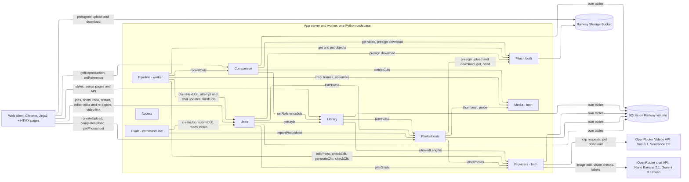
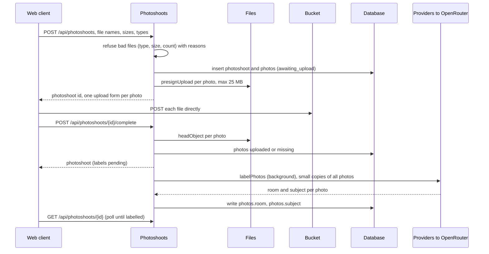
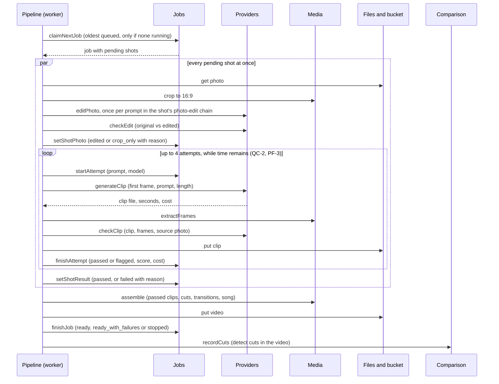
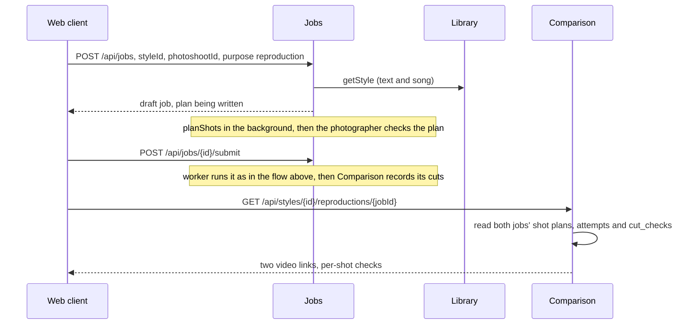
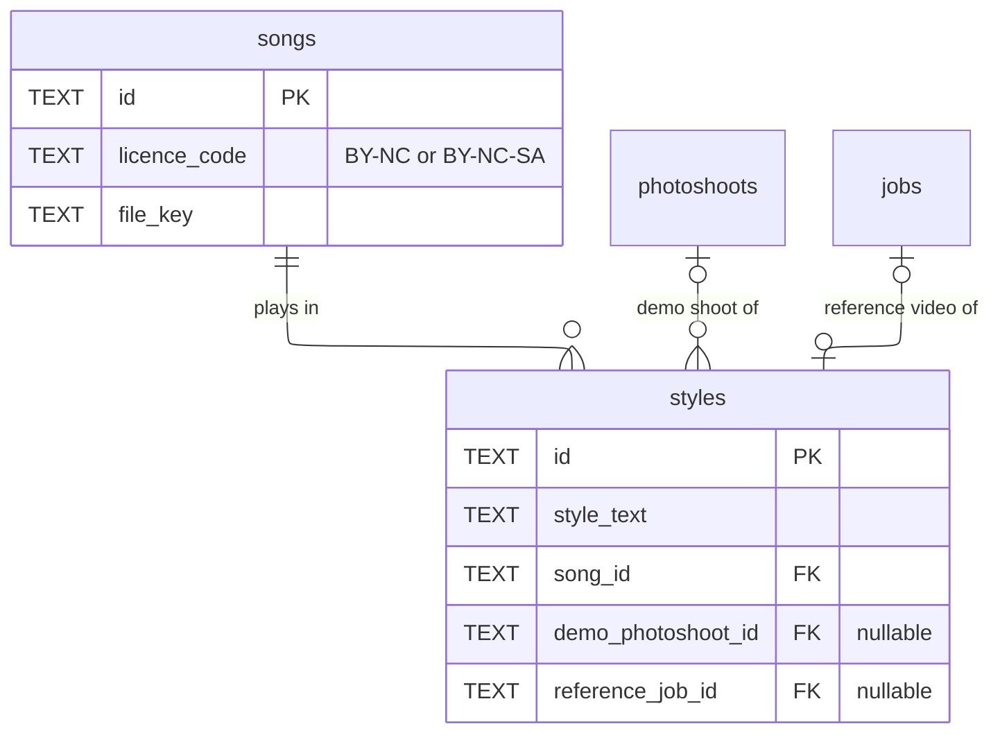
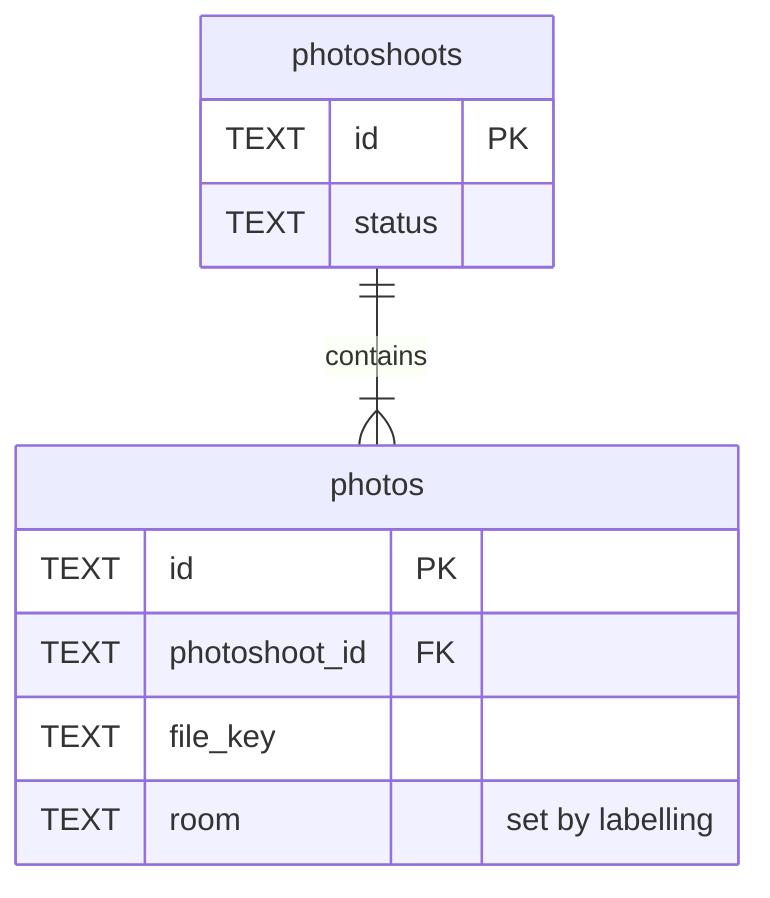
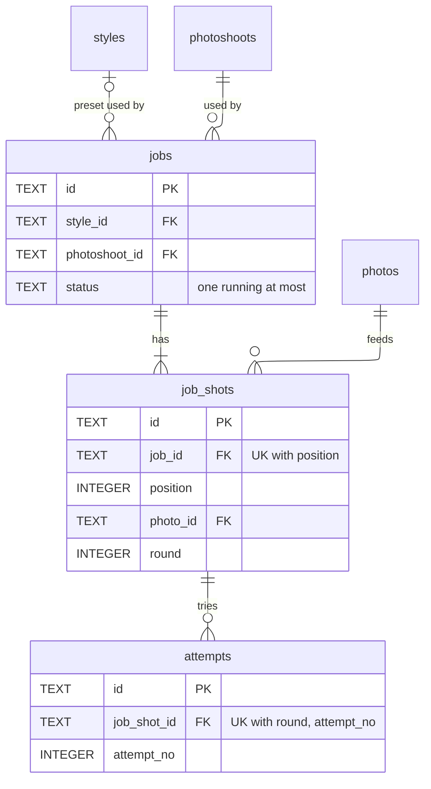

# ARCHITECTURE.md — AutoHDR Photo-to-Video

**What this document is.** The contracts between the parts of the system: the database schema, the API, the modules inside the app and the interface each surfaces, what goes to external services and storage, and how each interaction flows through them. Which boxes exist is `HIGH_LEVEL_DESIGN.md` (HLD); which technology fills each is `STACK.md`. How each module is built inside, and in what order, is left to the stories. Requirement IDs refer to `REQUIREMENTS.md`, metric names to `KEY_METRICS.md`. **[assumed]** marks a choice made without confirmation; each is listed under Assumptions.

## Summary

App server and background worker are two processes of one Python codebase in one container (STACK §3, §5). Modules marked *(worker)* run only in the worker process; *(both)* are libraries both processes call.



Every client route also passes through **Access** (the shared passphrase); those arrows are left off.

| Module | What it does | Owns (writes) | Serves | Called by |
|---|---|---|---|---|
| Access | Checks the shared demo passphrase on every request | none | every route | every route |
| Library | Songs and preset styles (style text + song) | `songs`, `styles` | listStyles, getStyle, listSongs, createStyle, updateStyle | client; Jobs; Comparison |
| Photoshoots | Uploads and labels photos | `photoshoots`, `photos` | createUpload, completeUpload, getPhotoshoot | client; Jobs; Library; Evals |
| Jobs | A job's life: draft, the shot plan written from the style text, queue, shots, attempts, finished video, and the web editor's edits | `jobs`, `job_shots`, `attempts` | createJob, updateJobShots, submitJob, restartJob, redoShot, editShot, exportJob, listJobs, getJob, getVideo | client; Pipeline; Comparison; Evals |
| Pipeline *(worker)* | Runs the next queued job end to end | none | none (no caller) | worker loop |
| Providers *(both)* | Every call to an outside AI service, and its cost record | `provider_calls` | none | Pipeline; Photoshoots; Library |
| Media *(both)* | Image and video processing (crop, frames, assemble, detect cuts) | none | none | Pipeline; Comparison; Photoshoots |
| Files *(both)* | Bucket key layout, presigned links, object reads and writes | none (bucket objects) | none | Photoshoots; Jobs; Pipeline; Comparison; Library (song links) |
| Comparison | Cut times detected in finished videos; reference video vs reproduction | `cut_checks` | getReproduction, setReference | client; Pipeline |
| Evals | Runs EV-1 and EV-2 and writes their reports | none (report files) | command line only | builder |

**Key decisions.**
- **One job runs at a time is a database rule:** a partial unique index allows at most one `jobs` row with status `running` (SC-1).
- **Only the Jobs module writes job state.** The worker's Pipeline owns no tables and changes jobs, shots and attempts only through Jobs' interface, so the app and worker never write the same rows two ways.
- **A style is text; each job gets its own shot plan.** A style is a name, a style text and a song (REQUIREMENTS 0a #8); no storyboard or creator video is stored. On createJob the planner turns the job's style text and photos into `job_shots`, which the photographer edits before submitting. The job keeps the text it was made from, so editing a preset never changes a job (CH-1, OB-1). After submit, only the web editor changes a job's shot, one shot at a time.
- **Restart, redo, editor re-export and first run are one path.** The worker runs every shot whose status is `pending`, then re-assembles the video from every shot not removed. "Start again", "Redo this shot" and "Re-export" only set shots back to `pending` and queue the job; a re-export with only length, transition or removal changes sets no shot pending and just re-cuts (FR-1.5, FR-1.12, FR-1.16).
- **A style's reference video is a job.** The author tries the style on a demo photoshoot and marks the job they like as the reference video. Reproductions are laid beside it, and every video's cuts are checked against its own plan (FR-2.4, VR-2), so no outside video is ever needed (FR-3.6).
- **Every outside call writes one `provider_calls` row**, with cost reported by OpenRouter or computed from the list price under BYOK (CO-1).

## Existing system

None. This is a greenfield build. `tools/gen_clip.py` is a research script whose request shape (base64 `frame_images` first frame, `generate_audio: false`, poll then download with the API key) is the reference for Providers → `generateClip`. It is not imported by the app.

HLD entity mapping: HLD *Video* is the `video_*` columns of `jobs` (one video per job). HLD *Song* = `songs`. All other HLD entities map one to one.

## Data flows

| Operation | Path | Sync / async | Committed before response? |
|---|---|---|---|
| listStyles | client → Library.listStyles → read `styles`, `songs` | sync | n/a (read) |
| getStyle | client → Library.getStyle → read `styles`, `songs` | sync | n/a |
| listSongs | client → Library.listSongs → read `songs` | sync | n/a |
| createStyle | client → Library.createStyle → insert `styles` | sync | yes |
| updateStyle | client → Library.updateStyle → update the style's text, song or frame rate (jobs keep the text they used) | sync | yes |
| createUpload | client → Photoshoots.createUpload → insert `photoshoots`, `photos` (status `awaiting_upload`) → Files.presignUpload per photo → links | sync | yes |
| (browser upload) | client → bucket, one presigned POST per photo | sync, browser to bucket | n/a |
| completeUpload | client → Photoshoots.completeUpload → Files.headObject per photo → update `photos` → background: Providers.labelPhotos → update `photos.room` | sync accept, labels async | upload status yes, labels later |
| getPhotoshoot | client polls → read `photoshoots`, `photos` | sync | n/a |
| createJob | client → Jobs.createJob → insert `jobs` (draft, plan `planning`) → background: Photoshoots.listPhotos → Providers.planShots → validate → insert `job_shots` → plan `ready` | sync accept, plan async | job yes, plan later |
| updateJobShots | client → Jobs.updateJobShots → replace the draft's `job_shots` with the edited plan (draft only) | sync | yes |
| replanJob | client → Jobs.replanJob → new style text → plan `planning` → background planShots as in createJob | sync accept, plan async | yes |
| submitJob | client → Jobs.submitJob → `jobs` draft → queued | sync | yes |
| listJobs, getJob | client polls every 5 s → read `jobs`, `job_shots`, latest `attempts` | sync | n/a |
| getVideo | client → Jobs.getVideo → Files.presignDownload | sync | n/a |
| restartJob | client → Jobs.restartJob → every shot not `passed`, `skipped` or removed → `pending`, round + 1 (skipped and removed shots stay as they are); job → queued | sync | yes |
| redoShot | client → Jobs.redoShot → one shot → `pending`, round + 1, job → queued | sync | yes |
| editShot | client (editor) → Jobs.editShot → update one `job_shots` row's fields or `removed`; mark `needs_new_clip` if the photo, movement, prompts, speed or photo edit changed, or the new length + transition is longer than the shot's clip; a shot removed and put back with nothing else changed since the last video is unchanged | sync | yes |
| exportJob | client (editor) → Jobs.exportJob → shots with `needs_new_clip` → `pending`, round + 1; job → queued → worker makes those shots and re-cuts all shots not removed into a new video version | sync accept, work async | yes |
| Run next job | worker loop → Jobs.claimNextJob → per pending shot in parallel: Media.crop, Providers.editPhoto + checkEdit, Providers.generateClip + checkClip, Jobs attempt updates → Media.assemble → Files.put → Jobs.finishJob → Comparison.recordCuts | async | each step committed as it happens |
| Startup recovery | worker start → Jobs.recoverInterrupted (running job → `stopped`, open attempts closed) → Providers.recoverCalls (finished clips downloaded, open calls closed); app start → Photoshoots relabels any shoot left `labelling` | async | yes |
| setReference | client → Comparison.setReference → Library.setReferenceJob → update `styles.reference_job_id` | sync | yes |
| getReproduction | client → Comparison.getReproduction → read `cut_checks` for both jobs, `job_shots`, `attempts` | sync | n/a |
| Evals | builder runs command → Photoshoots.importPhotoshoot per test shoot (once) → Jobs.createJob + submitJob per shoot → waits → reads tables → writes report files | async, hours | n/a |

### Upload a photoshoot



### Make the video (the worker)



A provider error is written to the shot by `finishAttempt` as soon as it returns, so `getJob` shows it within one poll (RL-1: reported "within 60 s of occurring"). An out-of-credit answer stops the whole job (see Pipeline → Failure behaviour).

### Reproduce a style and compare



## Database schema

SQLite, one file, WAL mode, foreign keys on. Types are SQLite storage classes: ids are `TEXT` UUIDs made by the app, times are `TEXT` ISO-8601 in UTC, money is `REAL` US dollars, durations are `REAL` seconds. Value sets in check constraints may grow by a routine migration. "Owned by" means only that module's code writes the table; any module may read it.

### Library tables



#### `songs` — owned by Library

One Creative Commons track. Rows are added by a seed command, not through the UI.

| Column | Type | Null | Default | Meaning |
|---|---|---|---|---|
| id | TEXT | no | | UUID |
| title | TEXT | no | | Track title |
| artist | TEXT | no | | Artist name, shown in the credit line |
| licence_code | TEXT | no | | `BY-NC` or `BY-NC-SA` (GC-5) |
| source_url | TEXT | no | | Where the track was downloaded |
| file_key | TEXT | no | | Bucket key of the audio file |
| duration_s | REAL | no | | Track length |
| created_at | TEXT | no | now | |

- **Constraints:** check `licence_code in ('BY-NC','BY-NC-SA')`. ND licences are refused (GC-5, STACK §10).

#### `styles` — owned by Library

A preset style: a written style plus its song (REQUIREMENTS Definitions).

| Column | Type | Null | Default | Meaning |
|---|---|---|---|---|
| id | TEXT | no | | UUID |
| name | TEXT | no | | Shown on the preset card |
| author_name | TEXT | no | | Who wrote it; any name, since there are no accounts (FR-3.2). Creators' presets and the photographer's own appear together (FR-1.2) |
| style_text | TEXT | no | | The written style: pacing and length, movements by name, speed, light and photo look, transitions, mood |
| song_id | TEXT → songs.id | no | | The style's song |
| song_offset_s | REAL | no | 0 | Where in the song the video starts |
| fps | INTEGER | no | 30 | Frame rate of every video made from the style, 24 or 30 (DE-5) |
| demo_photoshoot_id | TEXT → photoshoots.id | yes | null | The demo shoot the author tried it on (FR-2.1); null for a style the photographer saved from a job |
| reference_job_id | TEXT → jobs.id | yes | null | The author's approved video of this style (FR-2.2, FR-2.4) |
| created_at, updated_at | TEXT | no | now | |

- **Constraints:** `name` unique; check `fps in (24, 30)`; check `length(style_text) between 1 and 4000`.

### Photoshoots tables



#### `photoshoots` — owned by Photoshoots

| Column | Type | Null | Default | Meaning |
|---|---|---|---|---|
| id | TEXT | no | | UUID |
| label | TEXT | yes | null | Optional name, e.g. the property address |
| status | TEXT | no | `awaiting_upload` | `awaiting_upload`, `labelling`, `ready`, `label_failed` (more may be added) |
| created_at | TEXT | no | now | |

#### `photos` — owned by Photoshoots

| Column | Type | Null | Default | Meaning |
|---|---|---|---|---|
| id | TEXT | no | | UUID |
| photoshoot_id | TEXT → photoshoots.id | no | | |
| position | INTEGER | no | | Upload order, from 1 |
| original_name | TEXT | no | | File name as uploaded |
| content_type | TEXT | no | | `image/jpeg` or `image/png` (DE-2) |
| size_bytes | INTEGER | no | | Declared size; checked again by the bucket |
| file_key | TEXT | no | | Bucket key |
| status | TEXT | no | `awaiting_upload` | `awaiting_upload`, `uploaded`, `missing`, `too_large` (more may be added) |
| width, height | INTEGER | yes | null | Read after upload |
| room | TEXT | yes | null | `Room` value from labelling |
| subject | TEXT | yes | null | Short description from labelling, e.g. "kitchen island with pendants" |

- **Constraints:** unique `(photoshoot_id, position)`; check `size_bytes <= 26214400` (25 MB, DE-2); check `content_type in ('image/jpeg','image/png')`.

### Jobs tables



#### `jobs` — owned by Jobs

One run of photoshoot + style text + song → shot plan → video. The video's own columns are here (HLD *Video*).

| Column | Type | Null | Default | Meaning |
|---|---|---|---|---|
| id | TEXT | no | | UUID |
| style_id | TEXT → styles.id | yes | null | The preset the text came from, if any |
| style_text | TEXT | no | | The style text this job was planned from, as the photographer left it |
| photoshoot_id | TEXT → photoshoots.id | no | | |
| plan_status | TEXT | no | `planning` | `planning`, `ready`, `failed` (more may be added) |
| plan_notes | TEXT | yes | null | What the planner could not follow, e.g. "the text asks for a pool; no pool photo" (FR-1.10) |
| purpose | TEXT | no | `video` | `video` or `reproduction` (FR-2.3) |
| status | TEXT | no | `draft` | `JobStatus` (Shared types) |
| stop_reason | TEXT | yes | null | `StopReason` when status is `stopped` |
| song_id | TEXT → songs.id | no | | The song chosen with the style text |
| song_offset_s | REAL | no | | From the preset, or 0 |
| created_at | TEXT | no | now | |
| first_submitted_at | TEXT | yes | null | Set once, by the first submit; PF-1 and PF-2 are measured from here |
| submitted_at | TEXT | yes | null | Set by submit, restart, redo and export: when the current run was queued |
| started_at | TEXT | yes | null | When the worker claimed the current run |
| deadline_at | TEXT | yes | null | `started_at` + 30 min: the generation budget of the current run (PF-3). Time spent waiting behind another job is not taken from it |
| finished_at | TEXT | yes | null | When the current run reached `ready`, `ready_with_failures` or `stopped`; for a stop, also when the user was told (RL-1) |
| first_finished_at | TEXT | yes | null | Set once, when the first run finished; PF-1 uses it |
| fps | INTEGER | no | | From the preset, or 30 |
| video_key | TEXT | yes | null | Bucket key of the current video version |
| video_version | INTEGER | no | 0 | 1 for the first video; +1 on every re-export, redo or restart that finishes |
| video_duration_s | REAL | yes | null | |
| video_width, video_height | INTEGER | yes | null | 1920 × 1080 (DE-5) |
| video_fps | REAL | yes | null | Should equal `fps` |
| total_cost_usd | REAL | no | 0 | Sum of this job's `provider_calls.cost_usd` (CO-1) |

- **Constraints:** check status in the `JobStatus` set; check `status <> 'stopped' or stop_reason is not null`.
- **Indexes:** unique partial index on `(status) where status = 'running'`: at most one running job (SC-1). `(status, submitted_at)`: the worker picks the oldest queued job. `(created_at desc)`: listJobs.

#### `job_shots` — owned by Jobs

One shot of the job's shot plan.

| Column | Type | Null | Default | Meaning |
|---|---|---|---|---|
| id | TEXT | no | | UUID |
| job_id | TEXT → jobs.id | no | | |
| removed | INTEGER | no | 0 | 1 when the photographer removed this room in the editor (FR-1.15); a removed shot is left out of the video and can be put back |
| needs_new_clip | INTEGER | no | 0 | 1 after an editor change that needs a new clip; cleared when exportJob sets the shot pending |
| edited_at | TEXT | yes | null | Last editor change to a shot field. Removing or putting back a shot does not set it; queuing a run again (restart, redo, export; a draft has no removed shot) sets every removed shot's `edited_at` to the run's `submitted_at`, so a shot put back reads as re-cut only if it was left out of the last video |
| position | INTEGER | no | | Order in the video, from 1 |
| room | TEXT | no | | What the shot shows: a `Room` value (Shared types) |
| photo_id | TEXT → photos.id | yes | null | The photo the shot is made from; null = skipped, the text asked for a room the photos lack (FR-1.10) |
| photo_edit_prompts | TEXT (JSON array of strings) | no | `[]` | The chain of edits toward composition, lens, angle and light, applied in order as in the PRD example (FR-1.8, STACK §7); empty = crop only |
| movement_name | TEXT | no | | A `MovementName` (REQUIREMENTS Definitions) |
| movement_prompt | TEXT | no | | Starts as the PRD starter-kit text for `movement_name`; the planner or photographer may adapt it |
| speed | TEXT | no | `slow` | `slow`, `medium` or `fast` (more may be added) |
| model | TEXT | no | | Video model id, e.g. `google/veo-3.1` |
| length_s | REAL | no | | How long the shot plays in the video |
| transition | TEXT | no | `cut` | Transition from the previous shot into this one: `cut` or `crossfade` (more may be added); ignored on the first shot |
| transition_s | REAL | no | 0 | Crossfade length; 0 for a cut. The crossfade ends at the cut, so this shot's clip starts `transition_s` early |
| plan_note | TEXT | yes | null | Why the planner chose this, or `changed_by_photographer`; shown on the plan card |
| status | TEXT | no | `pending` | `ShotStatus` (Shared types) |
| status_detail | TEXT | yes | null | What the photographer reads, e.g. "Attempt 2 of 4: flagged, a person appears" |
| failure_reason | TEXT | yes | null | `FailureReason` when status is `failed` |
| round | INTEGER | no | 0 | 0 on the first run; +1 for every shot a restart, redo or export sets back to `pending` |
| cropped_key | TEXT | yes | null | Bucket key of the 16:9 crop |
| edited_key | TEXT | yes | null | Bucket key of the edited photo used as first frame |
| edit_status | TEXT | yes | null | `edited` or `crop_only` |
| edit_note | TEXT | yes | null | Why the edit was not used, if `crop_only`; this is where a narrowed edit is recorded (REQUIREMENTS §5 item 4) |
| model_used | TEXT | yes | null | Model of the final attempt; differs from `model` when the fallback was used |
| final_attempt_id | TEXT → attempts.id | yes | null | The attempt whose clip is in the video |
| updated_at | TEXT | no | now | Changes whenever status or detail changes; RL-1 is measured from it |

- **Constraints:** unique `(job_id, position)`; check status in the `ShotStatus` set; check `status <> 'failed' or failure_reason is not null`; check `length_s > 0`; check `transition_s >= 0`; check `transition = 'cut' or transition_s > 0`.
- Plan fields are written by planShots, changed by the photographer while the job is a draft (updateJobShots), and after that only by editShot (FR-1.14).

#### `attempts` — owned by Jobs

One try at making a shot's clip.

| Column | Type | Null | Default | Meaning |
|---|---|---|---|---|
| id | TEXT | no | | UUID |
| job_shot_id | TEXT → job_shots.id | no | | |
| round | INTEGER | no | | The shot's round when this attempt ran |
| attempt_no | INTEGER | no | | 1 to 4: the first try plus up to 3 regenerations (QC-2) |
| prompt | TEXT | no | | The exact prompt sent (OB-1) |
| model | TEXT | no | | Model id actually used |
| requested_s | REAL | no | | Clip length requested |
| status | TEXT | no | `running` | `running`, `passed`, `flagged`, `error` (more may be added) |
| clip_key | TEXT | yes | null | Bucket key of the clip |
| check_ai_score | REAL | yes | null | 0–1, higher = looks more AI-generated (OB-2) |
| check_match_score | REAL | yes | null | 0–1, higher = closer to the source photo |
| check_notes | TEXT | yes | null | What the check saw, e.g. "a person appears in the mirror" |
| error | TEXT | yes | null | Provider error kind and message when status is `error`, or `worker_restarted` |
| cost_usd | REAL | no | 0 | Cost of the clip and its check |
| started_at, finished_at | TEXT | | | `finished_at` is when the result, or the error, became visible on the job page (RL-1) |

- **Constraints:** unique `(job_shot_id, round, attempt_no)`; check `attempt_no between 1 and 4`.

### Providers table

#### `provider_calls` — owned by Providers

One row per call to an outside AI service (CO-1).

| Column | Type | Null | Default | Meaning |
|---|---|---|---|---|
| id | TEXT | no | | UUID |
| kind | TEXT | no | | `label_photos`, `plan_shots`, `edit_photo`, `check_edit`, `generate_clip`, `check_clip` (more may be added) |
| model | TEXT | no | | Model id |
| job_id | TEXT → jobs.id | yes | null | Null for labelling, which happens before a job exists |
| job_shot_id | TEXT → job_shots.id | yes | null | |
| attempt_id | TEXT → attempts.id | yes | null | |
| photoshoot_id | TEXT → photoshoots.id | yes | null | For labelling |
| provider_request_id | TEXT | yes | null | OpenRouter's id for the request or video job |
| status | TEXT | no | `running` | `ok` or `error` (or `running` while in flight) |
| error_kind | TEXT | yes | null | `ProviderErrorKind` |
| error_message | TEXT | yes | null | First 500 characters |
| output_seconds | REAL | yes | null | Seconds of video returned, for clip calls |
| cost_usd | REAL | no | 0 | Cost in US dollars |
| cost_source | TEXT | no | `reported` | `reported` (from OpenRouter's response) or `list_price` (BYOK, seconds × listed price) |
| started_at, finished_at | TEXT | | | `finished_at` is when the answer arrived, or when the call's time limit ran out |

- **Indexes:** `(job_id)`: job totals and EV reports.

### Comparison table

#### `cut_checks` — owned by Comparison

The cut times detected in one finished video, one row per shot boundary.

| Column | Type | Null | Default | Meaning |
|---|---|---|---|---|
| job_id | TEXT → jobs.id | no | | |
| position | INTEGER | no | | The style position of the shot that starts at this cut |
| expected_s | REAL | no | | Where the cut should land: the sum of `length_s` of the shots before it that are in the video (failed, skipped and removed shots are left out) |
| detected_s | REAL | yes | null | Where the cut detector found it; null if not found. A detected cut matches the nearest expected cut within 0.5 s, and each detected cut is used once; a cut further off than 0.5 s is stored as not found. The window is wider than VR-2's ±0.1 s so out-of-limit cuts keep their error |
| error_s | REAL | yes | null | `detected_s − expected_s` |
| transition | TEXT | no | | Copied from the shot, so crossfade misses are read correctly |
| checked_at | TEXT | no | now | |

- **Constraints:** primary key `(job_id, position)`. Re-running the check replaces the job's rows. A cut is the moment the incoming shot is fully on screen; for a crossfade that is the end of the fade.

## Shared types

Types that cross more than one boundary.

```
JobStatus   draft | queued | running | ready | ready_with_failures | stopped   (more may be added)
ShotStatus  pending | editing | generating | checking | passed | failed | skipped   (more may be added)
StopReason  out_of_credit | worker_restarted | assembly_failed | no_shot_passed   (more may be added)
FailureReason
            flagged_every_attempt   all attempts failed the check (QC-2)
            provider_error          the provider returned an error on the last attempt
            refused                 the provider refused the content
            out_of_time             no time left before deadline_at (PF-3)
            no_photo                the plan skipped this shot: no matching photo (FR-1.10)
            job_stopped             the job stopped before this shot finished
            (more may be added)
ProviderErrorKind
            rate_limited | out_of_credit | refused | failed | timeout | bad_response   (more may be added)

Room        exterior_front | exterior_back | living | kitchen | dining | bedroom |
            bathroom | office | hallway | detail | aerial | other   (more may be added)

MovementName  the 12 PRD starter-kit names in REQUIREMENTS Definitions, stored as
              snake_case codes: dolly_in, dolly_in_timelapse, drone_top_down_descend,
              timelapse_variant, dolly_out, slider_truck_left_to_right,
              slider_truck_right_to_left, parallax_orbit, dolly_in_pan_right,
              crane_up, crane_down, orbit_hyperlapse   (more may be added)

Song {
  id, title, artist, licenceCode, sourceUrl
  durationS      track length
  credit         "title, artist, licence, source URL", shown with every video (GC-5)
}

Style {
  id, name, authorName
  styleText        the written style
  song             Song
  songOffsetS
  fps              24 or 30
  demoPhotoshootId null for a style saved from a job
  referenceJobId   null until the author marks one
}

PlannedShot {      what planShots returns and updateJobShots accepts, one per shot
  position, room
  photoId          null = skipped
  photoEditPrompts ordered list, empty = crop only
  movementName, movementPrompt, speed, model
  lengthS, transition, transitionS
  planNote
}

Photo {
  id, position, originalName, contentType, sizeBytes
  status        awaiting_upload | uploaded | missing
  room, subject null until labelled
  thumbUrl      presigned download link, 1 h
}

JobShot {
  id, position, room, movementName, movementPrompt, speed, photoEditPrompts,
  lengthS, transition, transitionS
  photoId          null = skipped
  removed          true when removed in the editor
  pendingChange    none | new_clip | recut_only   what the next re-export will do with it
  planNote         why the planner chose this, or changed_by_photographer
  editStatus       edited | crop_only | null before editing
  editNote         why the edit was not used
  model            model of the final attempt
  usedFallback     true when model differs from the plan's
  status           ShotStatus
  statusDetail     text for the photographer
  failureReason    FailureReason or null
  attempts         number of attempts in the current round
  clipUrl          presigned link to the final clip, when passed
}

Job {
  id, styleId, styleName, photoshootId, purpose
  styleText    the text this job was planned from
  planStatus   planning | ready | failed
  planNotes    what the planner could not follow
  status       JobStatus
  stopReason   StopReason or null
  submittedAt, startedAt, finishedAt
  elapsedS     now − submittedAt while running, finishedAt − submittedAt after
  totalCostUsd
  waitingBehind  id of the running job when this one is queued, else null (SC-1)
  shots        JobShot[]
  video        { url, durationS, width, height, version } or null
               version is jobs.video_version (INDEX architectural issue 3)
  songCredit   Song.credit
}

ClipResult {
  path, seconds, model
  costUsd, costSource   reported | list_price
  providerRequestId
}

ClipCheck {
  aiScore         0–1
  matchScore      0–1
  peopleCount     people seen in the clip that are not in the photo
  addedObjects    things in the clip that are not in the photo
  removedObjects  fixtures or features in the photo that disappear
  changedObjects  fixtures or features that change shape, count or place
  passed          scores within the configured thresholds and all three lists empty (VR-5)
  notes           short text for status_detail
}

EditCheck {
  addedObjects, removedObjects, changedObjects   as in ClipCheck, edited photo vs original
  architectureChanged  true if any of the three lists has a wall, window, door,
                       fixture or room feature (VR-5)
  notes
}

ProviderError { kind: ProviderErrorKind, message, retryAfterS or null }
```

## Module: Access — the shared passphrase

### What it does
Lets a request through only if it carries the demo passphrase (FR-3.2, STACK §11).

### Owns
Nothing.

### API
No routes of its own. It wraps every route except `GET /healthz`.

```
Every route
Caller     anyone with the passphrase
Request    HTTP basic auth, any user name, password = DEMO_PASSPHRASE
Errors     401 with a basic-auth challenge, no body detail
```

### Must hold
- No route other than `/healthz` answers without the passphrase.
- The passphrase is never logged.

## Module: Library — songs and preset styles

### What it does
Holds the songs and the preset styles (a style text plus a song), and fills the New video form from a preset.

### Owns
Writes `songs` (seed command only), `styles`.

### API

Pages under `/` render the same data as these JSON routes by calling the same module functions; the contract is the same with or without HTTP. This holds for every module.

```
listStyles   GET /api/styles                           serves FR-1.2, HLD I-1
Response   200 { styles: [{ id, name, authorName, styleText, song: Song, hasReference }] }

getStyle     GET /api/styles/{id}                      serves HLD I-1, I-9
Response   200 { style: Style, referenceVideoUrl | null }
Errors     404 style_not_found

listSongs    GET /api/songs                            serves FR-1.2, FR-2.1, GC-5
Response   200 { songs: Song[] }

createStyle  POST /api/styles                          serves FR-2.1, FR-2.2, FR-2.5, HLD I-8
Request    { name, authorName, styleText, songId, songOffsetS?, fps?, demoPhotoshootId? }
           A photographer saving their edited text sends the same fields (FR-2.5)
Response   201 { style: Style }
Errors     400 invalid_style — empty or too-long text, fps not 24 or 30
           404 song_not_found | photoshoot_not_found
           409 name_taken
           (more may be added)

updateStyle  PUT /api/styles/{id}                      serves FR-2.1, HLD I-8
Request    any of { name, styleText, songId, songOffsetS, fps }
Response   200 { style: Style }
Errors     400 invalid_style, 404 style_not_found, 409 name_taken
```

### Interface for other modules
```
getStyle(styleId) -> Style
  Throws StyleNotFound.

setReferenceJob(styleId, jobId)
  Records the style's reference video. Called only by Comparison.setReference.
```

### Calls out
Files.presignDownload for song previews and the reference video.

### Must hold
- Only Library writes `songs`, `styles`.
- A style holds text and a song only: no video, frames or storyboard taken from outside the product is ever stored (FR-3.6).
- Every song a style uses has a licence of BY-NC or BY-NC-SA (GC-5).
- Updating a style never changes a job that already exists (each job keeps its own text and plan).

## Module: Photoshoots — uploads and labels

### What it does
Accepts a photoshoot's photos straight into the bucket and labels each photo's room so the planner can write a shot plan (FR-1.1, FR-1.10).

### Owns
Writes `photoshoots`, `photos`.

### API
```
createUpload   POST /api/photoshoots                    serves FR-1.1, DE-2, HLD I-2
Request    { label?, files: [{ name, size, type }] }
Response   201 { photoshootId,
                 uploads: [{ photoId, name, url, fields }],   presigned POST, 15 min
                 refused: [{ name, reason }] }              reason: wrong_type | too_large (more may be added)
Errors     400 too_many_files — more than 40 (DE-2)
           400 no_valid_files
           (more may be added)

completeUpload  POST /api/photoshoots/{id}/complete      serves FR-1.1
Response   202 { photoshoot: { id, status, photos: Photo[] } }
           photos the bucket does not hold are marked missing; files over 25 MB are
           deleted and marked too_large; labelling starts. Calling it again re-checks
           missing photos and starts labelling only if the shoot is not already ready
Errors     404 photoshoot_not_found

getPhotoshoot   GET /api/photoshoots/{id}                serves FR-1.10 (poll for labels)
Response   200 { photoshoot: { id, label, status, photos: Photo[] } }
Errors     404 photoshoot_not_found
```

### Jobs and messages
```
labelPhotoshoot   started by completeUpload, and on app start for any shoot left labelling;
                  runs in a background thread of the app process
Trigger proof  internal only, no route
Reads          photos (uploaded)
Writes         photos.room, photos.subject; photoshoots.status labelling → ready | label_failed
Twice-safe     yes — labels are overwritten
On failure     status label_failed; createJob still works and the plan is
               planned from the photos alone, with a plan note saying rooms are unlabelled
```

### Interface for other modules
```
listPhotos(photoshootId) -> Photo[]
  Uploaded photos only, in upload order, with room and subject if labelled.
  Throws PhotoshootNotFound.

listPhotoshoots() -> [(id, label)]
  Read only. Every shoot past awaiting_upload, newest first. Used by the Styles page's
  shoot picker for "Make a reproduction" (S15); Compare (S18) and Create a style (S25)
  pick shoots the same way.

importPhotoshoot(paths, label) -> photoshootId
  Server-side upload of local files (Files.put), then the same checks and labelling
  as completeUpload. Used by Evals to load the 12 test shoots (GC-6).
```

### Calls out
- Files.presignUpload(key, contentType, maxBytes) for each photo, Files.headObject to confirm uploads and sizes, Files.get to read photos, Files.presignDownload for thumbnails.
- Media.probe and Media.thumbnail for size and small copies.
- Providers.labelPhotos(photos) with small copies (size is a setting) of every uploaded photo.

### Must hold
- No photo over 25 MB or of another type is used: the presigned form limits size where the bucket supports it [verify], and completeUpload checks every object's size and deletes any over 25 MB (DE-2).
- A photo's `file_key` never changes after creation.
- Photos are never written to the repository (GC-9).

## Module: Jobs — the life of a job

### What it does
Creates a job from a style text, a song and a photoshoot, has the planner write its shot plan, lets the photographer edit it, queues it, and holds every shot's and attempt's state for the page and the worker.

### Owns
Writes `jobs`, `job_shots`, `attempts`. Reads `styles` (through Library), `photos` (through Photoshoots), `provider_calls`.

### API
```
createJob    POST /api/jobs                            serves FR-1.2, FR-1.10, FR-2.3, FR-2.5, HLD I-3, I-11
Request    { photoshootId, styleText, songId, styleId?, purpose?: video | reproduction }
           styleId names the preset the text came from; its fps and song offset are used.
           A reproduction sends the preset's text unchanged.
Response   201 { job: Job }   status draft, planStatus planning; poll getJob for the plan
Errors     400 invalid_style — empty or too-long text
           404 style_not_found | photoshoot_not_found | song_not_found
           409 photoshoot_not_ready — still uploading (labelling may still run;
               the plan is then made from the photos alone)
           (more may be added)

replanJob    POST /api/jobs/{id}/plan                  serves FR-1.2, FR-1.10
Request    { styleText?, songId? }   the photographer changed the text on the plan page
Response   202 { job: Job }   planStatus planning; the old plan is replaced when ready
Errors     404 job_not_found, 409 not_draft, 400 invalid_style

updateJobShots  PUT /api/jobs/{id}/shots               serves FR-1.10, HLD I-11
Request    { shots: PlannedShot[] }   the whole edited plan: shots changed, added, removed, reordered
Response   200 { job: Job }
Errors     404 job_not_found
           409 not_draft | plan_not_ready
           400 invalid_plan — names each bad shot: unknown movement, photo not in this
               photoshoot, length longer than the model's longest clip
           (more may be added)

submitJob    POST /api/jobs/{id}/submit                serves FR-1.3, SC-1, HLD I-3
Response   202 { job: Job }   queued; waitingBehind set if another job runs
Errors     404 job_not_found, 409 not_draft, 409 no_shots_to_make

restartJob   POST /api/jobs/{id}/restart               serves FR-1.5
Response   202 { job: Job }   every shot not passed is pending again in a new round
                              (whatever its failure reason); passed shots are kept
Errors     404 job_not_found, 409 not_stopped

editShot     PATCH /api/jobs/{id}/shots/{position}     serves FR-1.13, FR-1.14, FR-1.15, HLD I-13
Request    any of { photoId, movementName, movementPrompt, speed, photoEditPrompts,
                    lengthS, transition, transitionS, removed }
Response   200 { shot: JobShot, exportPlan: { newClips, recutOnly, removed } }
Errors     404 job_not_found | shot_not_found
           409 job_busy — job is queued or running
           409 not_finished — the job is a draft or stopped
           400 invalid_edit — names the field: unknown movement, photo not in this
               photoshoot, length longer than the model's longest clip
           (more may be added)

exportJob    POST /api/jobs/{id}/export                serves FR-1.16, PF-4, HLD I-13
Response   202 { job: Job }   queued; only shots needing a new clip are made again
Errors     404 job_not_found, 409 job_busy, 409 not_finished
           409 nothing_to_export — no edit since the last video

redoShot     POST /api/jobs/{id}/shots/{position}/redo serves FR-1.12, HLD I-12
Response   202 { job: Job }
Errors     404 job_not_found | shot_not_found
           409 job_busy — job is queued or running
           409 not_finished — the job is a draft or stopped (use restart)
           409 no_photo — the shot has no photo
           409 shot_removed — the shot is removed; put it back first

listJobs     GET /api/jobs                             serves FR-1.11, HLD I-6
Response   200 { jobs: [{ id, styleName, photoshootLabel, purpose, status, submittedAt, elapsedS }] }
           newest first

getJob       GET /api/jobs/{id}                        serves FR-1.3, FR-1.5, RL-1, HLD I-5
Response   200 { job: Job }
Errors     404 job_not_found

getVideo     GET /api/jobs/{id}/video                  serves FR-1.9, HLD I-7
Response   200 { url, downloadUrl, durationS }   url plays inline, downloadUrl saves the file, 1 h
Errors     404 job_not_found, 409 no_video
```

### Jobs and messages
```
planJob   started by createJob and replanJob; runs in a background thread of the app
          process, like labelling (A-3), so it never waits behind a running job
Trigger proof  internal only, no route
Reads          the job's style text and song, the photoshoot's photos and labels
Calls          Providers.planShots, then checks the plan: movement names known, each
               length + transition fits the model's longest clip, total length fits the
               song after its offset, photos belong to the photoshoot
Writes         job_shots (the plan), jobs.plan_status ready | failed, jobs.plan_notes
Twice-safe     yes — a new plan replaces the draft's shots
On failure     an invalid plan is asked for once more with the errors listed; then
               plan_status failed with the reason, and the page offers "Try again" or
               writing the plan by hand (updateJobShots accepts a full plan)
```
On app start, a job left in `planning` is planned again.

### Interface for other modules
```
claimNextJob() -> Job | None
  Moves the oldest queued job to running, only if no job is running, and returns it
  with its pending shots. None when there is nothing to do.
  Callers rely on: two callers can never both get a job (unique running index).

recoverInterrupted()
  Called once when the worker starts. Every running job → stopped, stop_reason
  worker_restarted; its in-flight shots → failed with job_stopped; every running
  attempt → error worker_restarted. "Start again" then re-runs them.

setShotState(jobShotId, status, detail)
setShotPhoto(jobShotId, croppedKey, editedKey | None, editStatus, editNote)
startAttempt(jobShotId, prompt, model, requestedS) -> attemptId
  Throws AttemptLimitReached after attempt 4 of the shot's current round (QC-2).
finishAttempt(attemptId, status, clipKey?, check?: ClipCheck, error?: ProviderError, costUsd)
setShotResult(jobShotId, passed | failed, failureReason?, finalAttemptId?)
finishJob(jobId, status, stopReason?, video?: { key, durationS, width, height, fps })
  Also totals provider_calls.cost_usd into total_cost_usd.
stopJob(jobId, stopReason)
  Marks every pending or in-flight shot failed with job_stopped and the job stopped.
cutPlan(jobId) -> { songKey, songOffsetS, fps, videoVersion,
                    shots: [{ position, status, clipKey | None, lengthS, transition, transitionS }] }
  What assembly needs: the song's bucket key, the job's offset, fps and current video
  version, and every shot not removed, in position order. clipKey is the clip of the
  shot's final attempt, if it has one. Throws JobNotFound.

After a job is no longer running, every write for it except finishJob's first call
raises JobNotRunning, and the Pipeline drops that shot's work.

createJob / submitJob as in the API, for Evals.
```
Every function is one short transaction, safe to call from several worker threads at once.

Shot states move only along: pending → editing → generating → checking → (generating again | passed | failed); pending → skipped when there is no photo; failed or passed → pending only through restart, redo or an editor re-export, with round + 1.

### Calls out
Files.presignDownload for the video (inline and as an attachment) and for final clips.

### Must hold
- Only Jobs writes `jobs`, `job_shots`, `attempts`.
- At most one job is `running` (unique partial index, SC-1).
- A job's copied shot fields change only through updateJobShots before submit and editShot after (CH-1); restart, redo and export never change them.
- `attempt_no` never exceeds 4 per shot per round (QC-2).
- A shot never moves to `failed` without a `failure_reason`, and a failed shot is always listed in `getJob` (RL-2).
- A job never reaches `ready` with a shot still `pending` or in flight.
- `getJob` returns only the final passed clip of a shot, never a flagged attempt's clip (FR-1.7).
- A re-export never changes a shot the photographer did not edit: its `final_attempt_id` and clip stay the same (FR-1.16, USERS UC-3 must never).
- Any departure from the style shot (crop only instead of the edit, the fallback model, a reused or skipped photo) is shown on the shot (USERS UC-1 must never).

### Failure behaviour
| Failure | What the caller / user sees | What is recorded |
|---|---|---|
| Submit while another job runs | Job page says "Waiting for job {n} to finish" | status queued, waitingBehind |
| Worker restarted mid-job | Job stopped, reason "the worker restarted", "Start again" | stop_reason worker_restarted |

## Module: Pipeline — runs a job (worker)

### What it does
Polls Jobs for the next queued job, makes every pending shot at once, and cuts the passing clips to the song (FR-1.4–FR-1.8, PF-1).

### Owns
Nothing. All writes go through Jobs, Comparison and Files.

### Jobs and messages
```
runNextJob   worker loop, polls Jobs.claimNextJob every few seconds   serves HLD I-4, I-12
Trigger proof  none needed — the worker process takes no outside input
Reads          the claimed job, its shots, photos, song
Writes         through Jobs: shot states, attempts, final job state; through Files: crops,
               edited photos, clips, video; through Comparison: cut checks
Twice-safe     a job is claimed once (unique running index); a restarted job re-runs only
               shots that are pending
On failure     see Failure behaviour; nothing is retried after deadline_at
```

What it does per pending shot, as the contract other modules see it:
1. Crop the photo to 16:9 (Media). If the shot has photo-edit prompts, apply them in order (Providers.editPhoto), check the result against the crop (Providers.checkEdit), retry the chain once if architecture changed, then fall back to the crop with `edit_status = crop_only` and a note (FR-1.8, VR-5). If the image model fails or refuses, the chain is retried on `ENHANCE_MODEL_FALLBACK` before falling back to the crop.
2. Build the prompt: the shot's movement prompt, its speed, and a fixed lock text based on the extra-lock sentence in `VIDEO_RESEARCH.md` §7.3 (no people, no reflections of people or cameras, same fixtures). §7.3 found the vent instruction was ignored once, so the check, not the prompt, is what enforces VR-5. The full prompt is stored on the attempt (OB-1).
3. Request a clip of the shortest length the model allows that covers `length_s + transition_s` (STACK §6), at the model's configured resolution (1080p unless configured otherwise, DE-5).
4. Check the clip (Providers.checkClip with frames from Media, at a frame rate set in configuration). Passed → shot passed. Flagged → next attempt, up to 4 per round, while `deadline_at` leaves time for one more clip and check.
5. If the shot's model returns `refused`, or `failed` twice, the remaining attempts use `VIDEO_MODEL_FALLBACK`, and the shot shows it.
6. Shots run in parallel; the number in flight is a setting.

Then assemble: passed clips of shots not removed, in position order, each trimmed to `length_s` plus its incoming `transition_s`, joined with the shot's transition so each cut lands at the sum of the lengths before it, re-encoded at 1920 × 1080, 16:9, at the job's `fps`, over the song from `song_offset_s` (DE-5, VR-2). A failed or skipped shot leaves its slot out and the video is marked `ready_with_failures` (FR-1.6). If no shot passed, the job is `stopped` with `no_shot_passed` and every reason shown.

### Calls out
Jobs (interface above), Providers, Media, Files, Comparison.recordCuts.

### Must hold
- A shot's clip is used only if its check passed (FR-1.7).
- One shot failing never stops the other shots (RL-3).
- A provider error or a usage or rate limit is reported to the user within 60 s of occurring (RL-1). For a timeout, it occurs when the call's time limit runs out.
- No clip is requested after `deadline_at` (PF-1, PF-3).
- Temporary files live on the container's disk, never on the volume (STACK §5).

### Failure behaviour
| Failure | What the user sees | What is recorded |
|---|---|---|
| Rate limited (429) or timeout on one clip | Shot detail "Provider busy, trying again"; the attempt counts | attempt error, provider_calls error_kind |
| Provider refuses the content | Shot failed: "The video service refused this photo" | failure_reason refused |
| Out of credit (402) | Job stopped: "The video service account is out of credit." Finished shots kept | stop_reason out_of_credit |
| All 4 attempts flagged | Shot failed: the last check's notes | failure_reason flagged_every_attempt |
| Deadline reached | Unfinished shots failed: "Ran out of time" | failure_reason out_of_time |
| Assembly fails | Job stopped: "Could not cut the video"; clips kept | stop_reason assembly_failed |

## Module: Providers — outside AI services

### What it does
Makes every call to OpenRouter, turns errors into one set of kinds, and writes a cost row for each call.

### Owns
Writes `provider_calls`.

### Interface for other modules
```
labelPhotos(photos: [{ photoId, jpegBytes }], photoshootId) -> [{ photoId, room: Room, subject }]
planShots(styleText, songDurationS, photos: [{ photoId, room, subject, jpegBytes }],
          movements: { name -> starterPrompt }, allowedLengths, ids) -> { shots: PlannedShot[], notes }
  Returns the shot plan as JSON in the PlannedShot shape; anything else → bad_response.
editPhoto(jpegBytes, prompt, ids) -> jpegBytes
checkEdit(originalJpeg, editedJpeg, ids) -> EditCheck
generateClip(firstFrameJpeg, prompt, model, lengthS, ids) -> ClipResult
  Submits, polls and downloads. Raises ProviderError.
checkClip(clipPath, frames: jpegBytes[], sourceJpeg, ids) -> ClipCheck
allowedLengths(model) -> number[]
  Clip lengths the model accepts, read from OpenRouter's model list and cached.
recoverCalls()
  Called once when the worker starts. For every generate_clip call still running
  with a provider request id: downloads the clip if it finished, so nothing is left
  at OpenRouter, and closes the row. The clip is kept in the bucket but not reused [assumed].

ids = { jobId?, jobShotId?, attemptId?, photoshootId? }, copied into provider_calls.
All raise ProviderError { kind, message, retryAfterS }.
Callers rely on: every call, ok or not, leaves exactly one provider_calls row with a
cost; a call never retries on its own after a 402.
```

### Calls out

| Call | Endpoint and model (from configuration) | Sent | Returned |
|---|---|---|---|
| generateClip | OpenRouter Videos API; `VIDEO_MODEL` default `google/veo-3.1`, fallback `bytedance/seedance-2.0`; the shot's `model` wins | model, prompt, duration, resolution 1080p, aspect ratio 16:9, audio off, the photo as a base64 first frame | job id → poll → clip file, downloaded with the API key; cost in `usage` |
| editPhoto | OpenRouter chat completions; `ENHANCE_MODEL` default `google/gemini-nano-banana-2.1`, `ENHANCE_MODEL_FALLBACK` default `google/gemini-3.1-flash-image` | the current photo, one photo-edit prompt ending "preserve all architectural and interior details" (PRD pp.10–12) | one image |
| planShots | OpenRouter chat completions; `PLANNER_MODEL` default `anthropic/claude-sonnet-5.5` (STACK §8a) | the style text, song length, small copies of the photos with their labels, the 12 movement names with their PRD starter-kit prompts, allowed clip lengths | JSON shot plan; anything else → `bad_response` |
| checkEdit, checkClip, labelPhotos | OpenRouter chat completions; `QUALITY_CHECK_MODEL` default `google/gemini-3.8-flash` | photos as images; for clips, the clip inline plus frames, both small enough for the inline limit | JSON matching EditCheck, ClipCheck or labels; anything else → `bad_response` |

- **Cost:** `cost_usd` is the cost OpenRouter reports. For a BYOK call (the response's usage marks it [verify]; otherwise the models listed in the `BYOK_MODELS` setting), `cost_usd` = output seconds × the model's listed price per second and `cost_source = list_price` (CO-1).
- **Errors:** 429 → `rate_limited` (with the retry delay if the response gives one [verify]), 402 → `out_of_credit`, a moderation or content refusal → `refused`, 5xx or a failed job → `failed`, no answer within the call's time limit → `timeout`.
- **Test double:** `FakeProviders`, selected by `FAKE_PROVIDERS=1`. It returns a fixed image, a short generated test clip and scripted checks, and can be told to raise any `ProviderErrorKind` on a chosen call (RL-1–RL-3 tests). It writes `provider_calls` rows like the real one, with cost 0.

### Must hold
- The API key appears only in the request header, never in a log, a row or an error message.
- No clip is left undownloaded at OpenRouter once its job completes.

## Module: Media — image and video processing

### What it does
Local processing with Pillow, ffmpeg and PySceneDetect. No outside calls, no tables.

### Interface for other modules
```
crop16x9(imageBytes) -> jpegBytes        centre crop to 16:9, long side ≤ 1920 px
thumbnail(imageBytes, longSide) -> jpegBytes
extractFrames(clipPath, perSecond) -> jpegBytes[]
probe(videoPath) -> { durationS, fps, width, height }
assemble(clips: [{ path, lengthS, transition, transitionS }], songPath, songOffsetS,
         outPath, width, height, fps) -> { durationS }
  Re-encodes; every cut lands within one frame of the sum of lengths (VR-2).
detectCuts(videoPath) -> seconds[]
```
Raises MediaError with the tool's message.

### Must hold
- Cuts are re-encoded, never stream-copied, so they land on the requested frame (STACK §9).

## Module: Files — bucket objects

### What it does
Owns the key layout and every presigned link.

### Calls out
| Key | What | Written by |
|---|---|---|
| `photoshoots/{photoshootId}/{photoId}.jpg` or `.png` | Uploaded photo | the browser through a presigned POST, or Evals through importPhotoshoot |
| `jobs/{jobId}/shots/{position}/r{round}/cropped.jpg`, `edited.jpg` | Prepared first frames | Pipeline |
| `jobs/{jobId}/shots/{position}/r{round}/a{attemptNo}.mp4` | Every attempt's clip | Pipeline |
| `jobs/{jobId}/video-v{version}.mp4` | Each finished video version; earlier versions are kept | Pipeline |
| `songs/{songId}.{ext}` | Song audio | seed command |

```
presignUpload(key, contentType, maxBytes) -> { url, fields }   15 min, size range 1..maxBytes where supported [verify]
presignDownload(key, asAttachment, filename?) -> url             1 h
put(key, path) / get(key, path) / headObject(key) -> { sizeBytes } | None
```
- **Test double:** moto's S3 in tests (STACK §14).

### Must hold
- The bucket is private; every browser read or write goes through a presigned link.
- Presigned links are never logged.

## Module: Comparison — cut times and side by side

### What it does
Measures where the cuts landed in each finished video against its plan, and lays a reproduction beside its style's reference video (FR-2.4, VR-2).

### Owns
Writes `cut_checks`. Reads `jobs`, `job_shots`, `attempts`, `styles`.

### API
```
setReference   POST /api/styles/{id}/reference          serves FR-2.2, FR-2.4
Request    { jobId }
Response   200 { style: Style }
Errors     404 style_not_found | job_not_found
           409 not_eligible — the job is not ready, or was not made from this style's text

getReproduction  GET /api/styles/{id}/reproductions/{jobId}   serves FR-2.4, VR-2, VR-6, HLD I-9
Response   200 {
  reference:    { jobId, videoUrl, photoshootLabel },
  reproduction: { jobId, videoUrl, photoshootLabel },
  song:         { sameSong: bool, credit },
  sameText:     bool   the reproduction used the style's text unchanged,
  summary: { reference and reproduction: shotCount, totalS, medianShotS,
             movements used with counts, transitions used with counts },
  shots: [{ position, movementName, transition,
            reference: { lengthS, cutErrorS } | null,         by position; shot counts may differ
            reproduction: { lengthS, cutErrorS } | null,      cutErrorS is against the job's own plan
            flagged: bool }],                               the reproduction's shot failed, used a fallback,
                                                            or was changed in the editor
  maxCutErrorS                                         worst over both videos
}
Errors     404 style_not_found | job_not_found
           409 no_reference — the style has no reference video yet
           409 not_ready
```

### Interface for other modules
```
recordCuts(jobId)
  Detects cuts in the job's video and replaces its cut_checks rows. Called by Pipeline
  after finishJob. Failure is recorded on the row (detected_s null), never fails the job.
```

### Calls out
Media.detectCuts and Files.get to read the video; Files.presignDownload for both videos; Library.setReferenceJob.

### Must hold
- Only Comparison writes `cut_checks`.
- A reference video is always a ready job made from the style's text.

## Module: Evals — EV-1 and EV-2 (command line)

### What it does
Runs the evaluation jobs and writes their reports for the reviewer.

### Owns
No tables. Writes report files in the repo (text and numbers only, no photos, GC-9).

### Jobs and messages
```
evals import --folder {path}                     run once by the builder
Writes         photoshoots through Photoshoots.importPhotoshoot, one per test shoot folder

evals run --suite ev1 | ev2 --style {name}       run by the builder
Writes         jobs through Jobs.createJob + submitJob (the queue runs them one at a time);
               then a report and a reviewer sheet with one row per attempt, flagged ones
               included, each with a clip link: visibly_ai, room_changed,
               movement_matches, transition_matches; one row per plan with
               text_followed (VR-3) and one row per reproduction with
               looks_like_reference (VR-4)
evals report --sheet {csv}
Reads          the filled sheet, jobs, attempts, cut_checks
Writes         the final report: per video, visibly AI shots (VR-1), rooms changed (VR-5),
               cut error (VR-2), job time (PF-1); per style and shoot VR-2, VR-3, VR-4, VR-6;
               and of the attempts the reviewer failed, how many the check flagged (QC-1)
Twice-safe     yes — a run creates new jobs; reports are new files
On failure     a job that stops is reported with its reason; the run continues
```

## System-wide contracts

| Contract | Rule |
|---|---|
| Error format | Every JSON route returns `{ "error": code, "message": text }` with a snake_case code; pages show the message in place |
| Times | Stored in UTC as ISO-8601 text; shown in the browser's local time |
| Database | Foreign keys on and a busy timeout of several seconds on every connection; writes are short transactions (STACK §3) |
| Blocking work | Database, bucket and provider calls never run on the web server's event loop: routes that make them are plain (non-async) handlers, and background work such as labelling runs in a thread (STACK §1) |
| Scrubbing | Logs never contain the API key, the passphrase, presigned URLs or image or video data |
| Backup and restore | None required (HLD §1 row 3). The demo job's video is also downloaded and kept offline before the demo (DE-4) |
| Health | `GET /healthz` returns 200 if the database opens; no passphrase needed |
| Processes | One container runs the app and the worker; if either exits, both stop so the host restarts the container (STACK §5) |
| Configuration | Environment variables only: `OPENROUTER_API_KEY`, `OPENROUTER_BASE_URL`, `VIDEO_MODEL`, `VIDEO_MODEL_FALLBACK`, per-model resolution, `VIDEO_LIST_PRICES` (list price in USD per second used for BYOK cost, default `google/veo-3.1=0.20`), `ENHANCE_MODEL`, `ENHANCE_MODEL_FALLBACK`, `QUALITY_CHECK_MODEL`, `PLANNER_MODEL`, `BYOK_MODELS`, bucket credentials and name, `DATABASE_PATH`, `DEMO_PASSPHRASE`, `FAKE_PROVIDERS`, check thresholds, check frame rate, label image size, shots in flight, `CLIP_COLLECT_WINDOW_HOURS` (hours after a clip call started during which a finished clip that cannot be downloaded is retried by `recoverCalls`; default 24, then the row closes as `failed`). `.env.example` lists them |

## Measurement

| Metric (KEY_METRICS.md) | Data source | Added by this document? |
|---|---|---|
| Video wait time, slowest and typical (PF-1, PF-2) | `jobs.first_finished_at − jobs.first_submitted_at` | yes |
| Time to tell the user about a provider error (RL-1) | `provider_calls.finished_at` (error) to `attempts.finished_at` of the same attempt; for a stop, to `jobs.finished_at` | yes |
| Regeneration attempts per shot (QC-2) | count of `attempts` per shot and round, minus 1 | yes |
| Re-export time (PF-4) | `jobs.finished_at − jobs.submitted_at` of a run started by exportJob | yes |
| Shots dropped because every attempt was flagged (VR-1 proxy) | `job_shots` with `failure_reason = flagged_every_attempt`, per video | yes; replaces "delivered shots the check still flags", which is 0 by construction (upstream fix) |
| Cut-time error against the style (VR-2) | `cut_checks.error_s` | yes |
| Cost per call and per job (CO-1) | `provider_calls.cost_usd`, `jobs.total_cost_usd` | yes |
| Reviewer checks (VR-1, VR-3–VR-6, QC-1 catch rate) | Evals reviewer sheet | yes, report files |

## Environments and the regression gate

| Environment | What it connects to | Notes |
|---|---|---|
| Local | SQLite file on disk, dev bucket, OpenRouter or `FAKE_PROVIDERS=1` | Same Dockerfile as production |
| Test and CI | Temporary SQLite, moto bucket, FakeProviders | Never spends money |
| Production | Railway Hobby, SQLite on the volume, production bucket, OpenRouter with BYOK | Auto-deploy frozen on demo day |

The regression gate runs in GitHub Actions: ruff, pytest, Playwright against the app with fakes (STACK §15).

## Open questions and upstream fixes

| # | Question | Options and cost | Blocks | Resolved by |
|---|---|---|---|---|
| 1 | Does the planner follow a style text closely enough (FR-1.10, VR-3), and can the labelling model tell rooms apart? | A: planner writes the plan, photographer corrects (current); B: photographer writes the plan by hand, which updateJobShots already accepts | Nothing; the page lets the photographer change the assignment | First 12 shoots |
| 2 | Does OpenRouter accept a clip inline for Gemini video input at our sizes? [verify] | A: send the clip and frames (current); B: frames only; ClipCheck is the same | Pipeline check | First real check call |
| 3 | Quality-check thresholds and check frame rate (QC-1 [tbd], STACK §17) | Set from the first 12 test videos; stored as configuration | Nothing; defaults are permissive | Evals report |
| 4 | Does the cut detector find the end of a crossfade? | A: detect and accept misses for crossfades (current, `detected_s` null); B: measure crossfades from the style's own timing | VR-2 on crossfade shots | First reproduction |
| 5 | Is a written style precise enough for a reproduction to look "nearly identical" to the reference video (VR-4, REQUIREMENTS 0a #8)? | A: text only (current); B: also store the reference job's plan as a template for reproductions, with no outside video involved; adds one column to `styles` | VR-4 | EV-2 report |
| 6 | Do Railway buckets enforce size and type conditions on presigned POST? [verify] | A: yes, as written; B: no, completeUpload's size check and delete is the only guard (already in the contract) | Nothing | First upload test |
| 7 | Does OpenRouter's response mark BYOK calls, and give a retry delay on 429? [verify] | A: read them from the response; B: `BYOK_MODELS` setting and a fixed back-off; contracts unchanged | CO-1 accuracy | First real call |
| 8 | Veo 3.1 vs Veo 3.1 Lite or Fast (STACK §17) | Model id per style shot and in configuration; no contract changes | Cost only | One clip per tier on 3 photos |
| 9 | How far photo edits may move the angle (STACK §17, REQUIREMENTS §5 item 4) | Full PRD edits with crop-only fallback per shot, recorded in `job_shots.edit_note` | VR-5 | First 12 test videos |
| 10 | Seedance fallback at 1080p or 720p (STACK §17) | Per-model resolution setting, default 1080p | DE-5 when the fallback is used | First fallback call |
| 11 | How many clips may be in flight at once (HLD §7: recheck on the first full job) | A setting; 12 worked in research | PF-1 | First full job |
| 12 | A spend limit may be set later (GC-3, HLD §7) | `provider_calls` and `jobs.total_cost_usd` already hold what a limit needs; a limit would add one check before each call | Nothing now | Candidate, later |

The approved-provider question for BYOK Google billing is settled by GC-4 *(assumed, 2026-10-18)* and not reopened here.

**Assumptions.**

| # | Assumption | Where it is used | Confirm with |
|---|---|---|---|
| A-1 | Module grouping chosen without a reviewer: Pipeline owns no tables and writes through Jobs; Providers owns the cost table; Comparison owns cut checks | Summary | Candidate |
| A-2 | A style's reference video is the author's approved run on the demo shoot | Comparison, `styles.reference_job_id` | Candidate |
| A-10 | The shot plan is written in the app process in the background, like labelling | Jobs → planJob | Candidate |
| A-3 | Photos are labelled in a background thread of the app process, not by the worker, so labelling never waits behind a running job | Photoshoots → labelPhotoshoot | Candidate |
| A-4 | A rate limit counts as one of a shot's 4 attempts | Pipeline → Failure behaviour | Candidate |
| A-5 | A job with no passing shot is `stopped`, not delivered empty | Pipeline | Candidate |
| A-6 | Songs are added by a seed command, not through the UI | Library | Candidate |
| A-7 | The 30-minute budget (PF-3) runs from when the worker starts a job. A job waiting behind another can exceed PF-1 measured from first submit, which SC-1's queue allows | `jobs.deadline_at`, Measurement | Candidate |
| A-8 | A clip recovered after a worker restart is kept but not reused; the shot is made again on "Start again" | Providers → recoverCalls | Candidate |
| A-9 | The fallback video model takes over a shot after the style's model refuses it or fails twice | Pipeline step 5 | Candidate |

**Requirement rows.** None added. Every operation traces to an existing row.

**Upstream fixes.**
- HLD §4.1: add the supporting operations `completeUpload` and `getPhotoshoot` (the upload trace needs a step after the browser upload, and labels must be polled, FR-1.10), and `setReference` (FR-2.4 needs an original). `createReproduction` is `createJob` with `purpose: reproduction` and the preset's text unchanged, and its route is `POST /api/jobs`.
- HLD §4.1 and §5 App server: the app server now does background work, labelling photos through the quality-check service (A-3). The HLD says it "does no work on its own"; add the app → quality-check-service edge.
- HLD §5: add the Evals command-line process, which creates photoshoots and jobs and writes reports (EV-1, EV-2).
- HLD §3: *Video* is columns on `jobs`, not its own table. Add *Provider call* and *Cut check* entities.
- HLD §4.3: operations renamed here: `enhancePhoto` → `editPhoto` (now a chain of edits), `generateClip` / `getClip` → `generateClip` (polling is inside Providers), `scoreClip` → `checkClip`. Add `labelPhotos` and `checkEdit`.
- KEY_METRICS: "Delivered shots the automatic check still flags" is 0 by construction, since only passed clips are delivered. Replace it with "Shots dropped because every attempt was flagged" (Measurement).
- Wireframe: done (version 4, 2026-10-18): style text field filled from presets, the shot plan to check, shot cards with "Redo this shot", the editor, the original/reproduction picker, the song credit and the fallback and crop-only notes.
- `.env.example`: add `DEMO_PASSPHRASE`, bucket settings, `DATABASE_PATH`, `FAKE_PROVIDERS`, `VIDEO_MODEL_FALLBACK`, `ENHANCE_MODEL_FALLBACK`, `BYOK_MODELS`.
