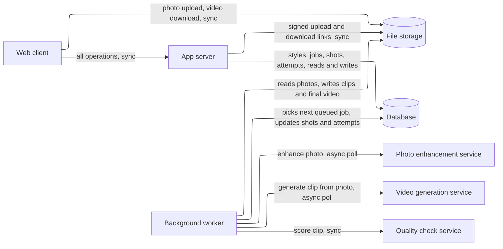
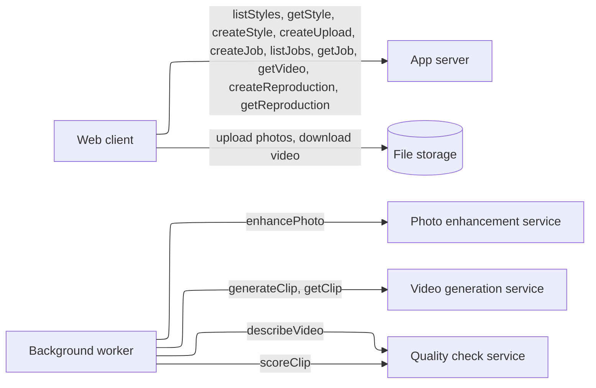

# HIGH_LEVEL_DESIGN.md — AutoHDR Photo-to-Video

**What this document is.** The parts the system needs and why, sized to the load it actually has. It names kinds of component, not products; `STACK.md` picks the products. How the code is organized inside the app is `ARCHITECTURE.md`'s. Requirement IDs refer to `REQUIREMENTS.md`. **[assumed]** marks an answer taken without confirmation; each is listed in §7.

## Summary

- **Load:** 1 user, 1 job at a time (SC-1). About 12 test jobs plus a few demo runs in total, so under 50 jobs over the project. Peak is about 0.2 browser requests/s. Each job is 10–30 minutes of work that is almost all waiting on outside AI services. About 10 GB of files in total (55 GB worst case, §2).
- **Design:** One app server, one background worker, one database, file storage, and three outside AI services (video, photo enhancement, quality check). The job queue is a table in the database.
- **Wireframe:** [Photo to Video wireframe](https://claude.ai/artifact/Y9f7bkitn6dqRLvP5sN5vH), clickable: Styles, New video (upload), Jobs, Job (running, waiting, stopped, partly failed, ready), Create a style, Original vs reproduction. Use the Tweaks panel to jump to each state.
- **Next as it grows:** final for the demo. The scaling write-up (GC-7) names two pieces for more than one user: a real queue with more workers, and a paid tier at the outside services. Triggers are in §5.
- **Cost:** $0 now and at the horizon, against a budget of $0 (CO-1, GC-3). Every box must run on a free tier or the builder's own machine.



## 1. Sizing answers

| # | Question | Answer | Source |
|---|---|---|---|
| 1 | Users now, growth, peak | 1 user at a time, no growth planned; the scaling is explained in writing, not built. Peak is the demo itself, with one browser. | SC-1, SC-2, GC-7 |
| 2 | Read- or write-heavy | Neither in the usual sense. Browser reads (status polling) outnumber writes about 100:1, but the real work is long jobs calling outside services. The heaviest interaction is the job itself (I-4). | FR-1.3, PF-1 |
| 3 | Data that can never be lost | None. Uploads, styles and videos only need to last through the demo. One exception worth keeping: the pre-generated demo job and the demo styles must survive until the demo (DE-4). | U§7, U§10, DE-4 |
| 4 | Latency expected | Screens: under 1 s. Job: median 10 min, at most 30 min. Error message: within 60 s. See §2. | PF-1, PF-2, RL-1 |
| 5 | Cost ceiling | $0 | CO-1, GC-3 |

## 2. Interactions and load

| # | Interaction | R/W | How often | Peak/s | Expected latency | Data touched | Can be lost? | Source |
|---|---|---|---|---|---|---|---|---|
| I-1 | See the style library | R | ~1 per session | <0.1 | ≤ 1 s | Style, Song | No (demo styles kept) | FR-1.2 |
| I-2 | Upload a photoshoot | W | ~1 per job, up to 40 photos | <0.1 | Upload finishes as fast as the connection allows; page responds ≤ 1 s | Photoshoot, Photo | Only through the demo | FR-1.1, DE-2 |
| I-3 | Submit a job | W | ~1 per job | <0.1 | ≤ 1 s to accept | Job | Only through the demo | FR-1.3 |
| I-4 | Make the video (system, in the background) | W | 1 job at a time | — | median 10 min, max 30 min | Job, Job shot, Attempt, Video | Only through the demo | FR-1.4–1.8, PF-1, PF-2 |
| I-5 | Check job status (browser polls) | R | every 5 s while a job page is open | 0.2 | ≤ 1 s | Job, Job shot | — | FR-1.3 |
| I-6 | List jobs, open a past job | R | a few per session | <0.1 | ≤ 1 s | Job | No (demo job kept) | FR-1.3 |
| I-7 | Play and download the video | R | ~1 per job | <0.1 | Starts in a few seconds | Video | Only through the demo | FR-1.9 |
| I-8 | Create a style (three methods) | W | 2–3 per project | <0.1 | Save ≤ 1 s; reading a past video runs in the background, minutes are fine | Style, Style shot, Song | Kept through the demo | FR-2.1, FR-2.2 |
| I-9 | Reproduce a style on its demo shoot, compare side by side | W then R | once per style | <0.1 | Same as I-4 | Style, Job, Video | Kept through the demo | FR-2.3, FR-2.4 |
| I-10 | Apply a saved style to another photoshoot | W | same as I-3 | — | same as I-3 | Style, Job | — | FR-2.5 |

**Arithmetic.**
- Browser requests: 1 user × 1 poll per 5 s = 0.2/s while a job page is open. Everything else is a few per minute. Total peak under 1/s.
- Jobs: 12 test jobs (GC-6) + about 3 demo styles × 2 runs + about 20 retries of whole jobs while building = under 50 jobs.
- Files per job (upper bound from DE-2): 40 photos × 25 MB = 1 GB. Typical shoot: 28 photos × 5 MB = 140 MB. A video of 6–8 shots: about 50 MB. So worst case under 50 jobs × 1.1 GB = 55 GB; typical about 10 GB. Both fit a free file-storage tier or local disk with room to spare; the worst case does not, so the worker deletes a job's source photos after the demo (see §7).
- Calls to outside services per job, worst case, with 8 shots and up to 3 regenerations each (QC-2): photo enhancement 8 (one per shot), video generation 8 × 4 = 32, quality check 32. First pass only: 8 + 8 + 8. A job's time is then dominated by video generation, which is in the minutes per clip. At 4 clips in flight at once (an assumption on the provider's limit), 32 clips at about 2 minutes each is 16 minutes, inside the 30-minute limit (PF-1). That arithmetic rests on assumed clip times; it is checked on the first real run (§7).
- Free-tier limits are the real ceiling, not our servers. 12 test jobs × up to 32 clips = up to 384 clips, which may exceed a free tier. CO-1 already says the job stops and says so.

Load is a single browser and a few jobs. One small app server and one database handle it with more than 100× headroom. The design is shaped by the long wait on outside services, not by traffic.

## 3. Core entities

| Entity | What it is | Key attributes | Relations | Durability | Growth |
|---|---|---|---|---|---|
| Song | A Creative Commons non-commercial track | title, artist, license, source URL (GC-5) | 1 to n Style | keep through demo | <10 |
| Style | A saved storyboard plus its song | name, song, demo photoshoot, original video | has Style shots; belongs to a Song | keep through demo | 2–3 |
| Style shot | One slot in a style | order, camera-movement description, place in song, cut time | belongs to Style | keep through demo | 5–8 per style |
| Photoshoot | The photos uploaded for one property | uploaded at | has Photos | disposable | <50 |
| Photo | One uploaded image | file reference, type, size | belongs to Photoshoot | disposable | ≤ 40 per shoot |
| Job | One run of photoshoot + style | status, style, photoshoot, submitted, finished, total time, stop reason | has Job shots, one Video | disposable (demo job kept) | <50 |
| Job shot | One shot of a job | style shot, photo, enhanced photo reference, status, failure reason | belongs to Job; has Attempts | disposable | 5–8 per job |
| Attempt | One try at making a shot | prompt, model used, clip reference, check score, pass or fail | belongs to Job shot | disposable | up to 4 per shot (OB-1, OB-2) |
| Video | The finished file | file reference, length | belongs to Job | disposable (demo job kept) | <50 |

```mermaid
---
config:
  layout: elk
---
erDiagram
  SONG ||--o{ STYLE : "plays in"
  STYLE ||--|{ STYLE_SHOT : "has"
  PHOTOSHOOT ||--|{ PHOTO : "contains"
  STYLE ||--o{ JOB : "applied in"
  PHOTOSHOOT ||--o{ JOB : "used by"
  JOB ||--|{ JOB_SHOT : "has"
  STYLE_SHOT ||--o{ JOB_SHOT : "fills"
  PHOTO ||--o{ JOB_SHOT : "feeds"
  JOB_SHOT ||--|{ ATTEMPT : "tries"
  JOB ||--o| VIDEO : "produces"
```

**Access patterns**

| Read | Entities combined | How | At this scale |
|---|---|---|---|
| I-1 library | Style, Song | list with the song's title | fine as a query |
| I-5, I-6 job status and list | Job, Job shot | filter by job, sort by order | fine as a query |
| I-9 comparison table | Style shot, Job shot, Attempt | join by shot slot | fine as a query (tens of rows) |
| EV-1, EV-2 reports | Job, Job shot, Attempt | scan all jobs | fine as a query (under 50 jobs) |

## 4. API operations

Grouped by the component that **serves** each operation, with who **calls** it. Routes are sketches; exact contracts are `ARCHITECTURE.md`'s.



### 4.1 App server

| Operation | Called by | Input | Output | R/W | Latency class | Sync / async | Serves |
|---|---|---|---|---|---|---|---|
| `listStyles` — `GET /styles` | Web client | — | styles with song and shot count | R | ≤ 1 s | sync | I-1, FR-1.2 |
| `getStyle` — `GET /styles/{id}` | Web client | style id | style, its shots, its song | R | ≤ 1 s | sync | I-1, I-9 |
| `listSongs` — `GET /songs` | Web client | — | tracks with license and source | R | ≤ 1 s | sync | I-8, GC-5 |
| `createStyle` — `POST /styles` | Web client | name, song, method, shots or source files | Style (draft) | W | ≤ 1 s | sync save; reading a past video is async | I-8, FR-2.1, FR-2.2 |
| `updateStyleShots` — `PUT /styles/{id}/shots` | Web client | edited shot rows | Style | W | ≤ 1 s | sync | I-8 |
| `createUpload` — `POST /photoshoots` | Web client | file names, sizes, types | Photoshoot, signed upload links; refusal reasons for bad files | W | ≤ 1 s | sync | I-2, FR-1.1, DE-2 |
| `createJob` — `POST /jobs` | Web client | photoshoot, style | Job (queued, or refused with message if a job is running) | W | ≤ 1 s | sync accept; the work is async | I-3, FR-1.3, SC-1 |
| `listJobs` — `GET /jobs` | Web client | — | jobs with status | R | ≤ 1 s | sync | I-6, FR-1.3 |
| `getJob` — `GET /jobs/{id}` | Web client | job id | status, shots with status and failure reason, stop reason, time taken | R | ≤ 1 s | sync | I-5, FR-1.5, RL-1 |
| `getVideo` — `GET /jobs/{id}/video` | Web client | job id | signed download link | R | ≤ 1 s | sync | I-7, FR-1.9 |
| `createReproduction` — `POST /styles/{id}/reproduction` | Web client | style id | Job on the style's demo photoshoot | W | ≤ 1 s | sync accept; work async | I-9, FR-2.3 |
| `getReproduction` — `GET /styles/{id}/reproduction` | Web client | style id | original and reproduction links, match checks (song, cuts, movement) | R | ≤ 1 s | sync | I-9, FR-2.4 |

**Inside the app server (no caller):** none; it does no work on its own.

### 4.2 Background worker

The worker does not take calls. It reads the database for work.

**Inside the worker (no caller):**

| Work | Trigger | Does | Serves |
|---|---|---|---|
| Run next job | A queued job exists and no job is running | Picks the oldest queued job, marks it running. Per shot: enhance the photo, generate the clip, score it, regenerate up to 3 times if flagged, record every attempt. Cuts the clips to the style's cut times over the song. Marks the job ready, or ready with failed shots, or stopped. | I-4, FR-1.4–1.8, QC-2, RL-3 |
| Report provider failure | An outside service returns an error or a limit | Marks the shot or job with the reason within 60 s, keeps finished shots, stops without retrying into a charge | RL-1, RL-2, CO-1 |
| Read a past video | A style was created from a video | Describes each shot's camera movement and cut time into Style shots for the creator to edit | FR-2.1, I-8 |
| Compare reproduction | A reproduction job is ready | Compares song, cut times and movement type with the original and stores the result | VR-2, VR-3, FR-2.4 |

### 4.3 External services

| Operation | Called by | Input | Output | Latency class | Serves |
|---|---|---|---|---|---|
| `enhancePhoto` | Worker (run next job) | photo, style's composition and lighting notes | enhanced photo | seconds to a minute | FR-1.8 |
| `generateClip` / `getClip` | Worker (run next job) | enhanced photo (first and last frame if the service supports them), movement prompt | clip, delivered later; the worker polls | minutes | FR-1.4 |
| `scoreClip` | Worker (run next job) | clip, source photo | score for "looks AI-generated" and "matches source" | seconds | FR-1.7, QC-1 |
| `describeVideo` (same vision-capable service as the quality check) | Worker (read a past video) | past video | shots with movement type and cut times | minutes | FR-2.1 |

## 5. Components

### Web client

**Why it exists:** the photographer works in a desktop browser (FR-1.1, DE-1). **Wireframe:** [Photo to Video wireframe](https://claude.ai/artifact/Y9f7bkitn6dqRLvP5sN5vH). **Screens:**
- **Styles:** cards for each style with song and a "Use this style" button, a "See reproduction" link and a "Create a style" link. Only demo styles exist; no empty state is needed.
- **New video (upload):** the chosen style, a drop zone, the photo grid. States: empty, photos ready, invalid files (names the file and the reason; submit stays off and says why).
- **Jobs:** every job with its status; opens a job.
- **Job:** running (which shot, attempts), waiting (another job is running), stopped (names the shot and the reason, no charge), ready with failed shot marked, ready. Shot table with status and reason. Player and download once there is a video.
- **Create a style:** pick a method, name, song (with its license), editable shot table, save and run reproduction.
- **Original and reproduction:** two players, a play-both button, a table of checks (song, cuts, movement, flagged shots), keep or edit.
- No sign-in, no phone layout (FR-3.2, FR-3.4).

### App server

**Why it exists:** serves the operations in §4.1 and refuses a second job while one runs (SC-1). **Holds / does:** no state of its own, no long work. **Provided by platform:** HTTPS and restarts on a managed host; on the builder's machine, neither is needed for the demo.

### Background worker

**Why it exists:** one job takes 10–30 minutes (PF-1), longer than any web request can stay open, and an outside failure must be retried or reported per shot (RL-1, RL-3). That is the §4 async split. **Holds / does:** runs one job at a time, so one worker suffices for SC-1. **Provided by platform:** no; it is a second process of the same codebase. A separate queue broker is not added: the job table is the queue (cheaper first step from the ladder), because there is one worker and one job at a time.

### Database

**Why it exists:** every entity in §3 and the job log that OB-1 and OB-2 need. **Holds / does:** styles, jobs, shots, attempts. Under 10,000 rows. **Provided by platform:** backups, if the host gives them; none are required (nothing is "never lose").

### File storage

**Why it exists:** photos, clips and videos are large and do not belong in the database (§2 sizes: up to 1 GB per job). **Holds / does:** uploads, enhanced photos, clips, final videos, the songs. The browser sends and receives files directly through signed links so the app server never carries video. **Provided by platform:** the local disk would do for the demo; the kind stays "file storage" so `choose-stack` can pick.

### Photo enhancement service, Video generation service, Quality check service

**Why they exist:** FR-1.8 (improve the photo), FR-1.4 (movement from a still), FR-1.7 and QC-1 (catch visibly AI shots). They are outside services from the approved list or on a free tier (GC-4). They are the slowest and most limited boxes: speed, failure rate and free allowance live on the provider's side (KEY_METRICS guarantees). **Holds / does:** nothing of ours. **Provided by platform:** n/a.

### What to add next

For one user at a time the demo design is final. SC-2 asks for the written explanation of what changes to run N jobs; these are the pieces, with the measurable trigger that justifies each.

| Next piece | What breaks first | Add when (measurable) |
|---|---|---|
| Real queue and several workers | One worker runs one job at a time; the second job waits for the first, up to 30 min | Jobs waiting more than 5 min on the median, or a requirement for more than 1 job at once (SC-1 raised) |
| Paid tier at the outside services | Free-tier limits stop jobs (CO-1) | More than 1 job in 10 stops on a limit |

## 6. Cost envelope

| Component | Now | At horizon |
|---|---|---|
| App server, worker, database, file storage | $0: builder's machine or a free tier | $0 |
| Photo enhancement, video generation, quality check | $0: free tiers only | $0 |
| **Total** | **$0** | **$0 — within the $0 budget (CO-1)** |

Whether free tiers cover 12 test jobs is open (§7). If they do not, jobs stop and say so (CO-1); we do not pay. Exact prices and limits are in `STACK.md`.

## 7. Open questions and upstream fixes

| Item | Why it matters | Resolved by |
|---|---|---|
| [assumed] Providers allow about 4 clips in flight at once, and a clip takes about 2 minutes | Sizes the 16-minute estimate against PF-1 | First real run; adds a measured number to PF-1's check |
| [assumed] Source photos are deleted after the demo to keep storage within a free tier | Worst case is 55 GB | `choose-stack` after the free-tier limits are known |
| [assumed] A second job is queued, not refused; the wireframe shows both messages | Decides one screen state | Add to SC-1 which of the two |
| **Upstream fix** — FR: the photographer can see a list of their jobs and reopen one | The wireframe's Jobs screen; FR-1.3 says "come back", which needs a list | REQUIREMENTS.md, new FR-1.10 |
| **Upstream fix** — FR: a stopped job keeps its finished shots and offers "Start again" | Wireframe error state; RL-3 says remaining shots finish but not what the user can do | REQUIREMENTS.md, add to FR-1.5 |
| **Upstream fix** — FR: the creator can edit the shot rows of a new style before saving | Wireframe create-style screen; FR-2.1 says only that a style can be created | REQUIREMENTS.md, add to FR-2.1 |
| **Upstream fix** — FR: the comparison screen lists song, cuts, movement and flagged shots | Wireframe; VR-2 to VR-4 need somewhere to show their result | REQUIREMENTS.md, add to FR-2.4 |
| **Upstream fix** — a free-tier usage row (limit and what is left) | KEY_METRICS.md already lists it | REQUIREMENTS.md, once models are chosen |
