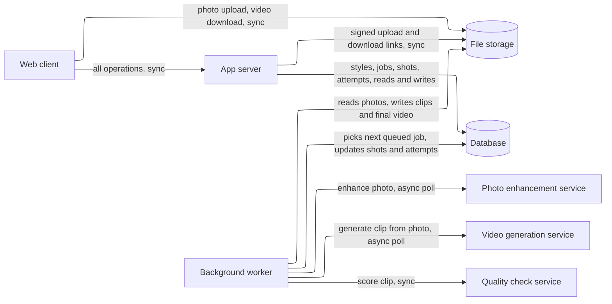
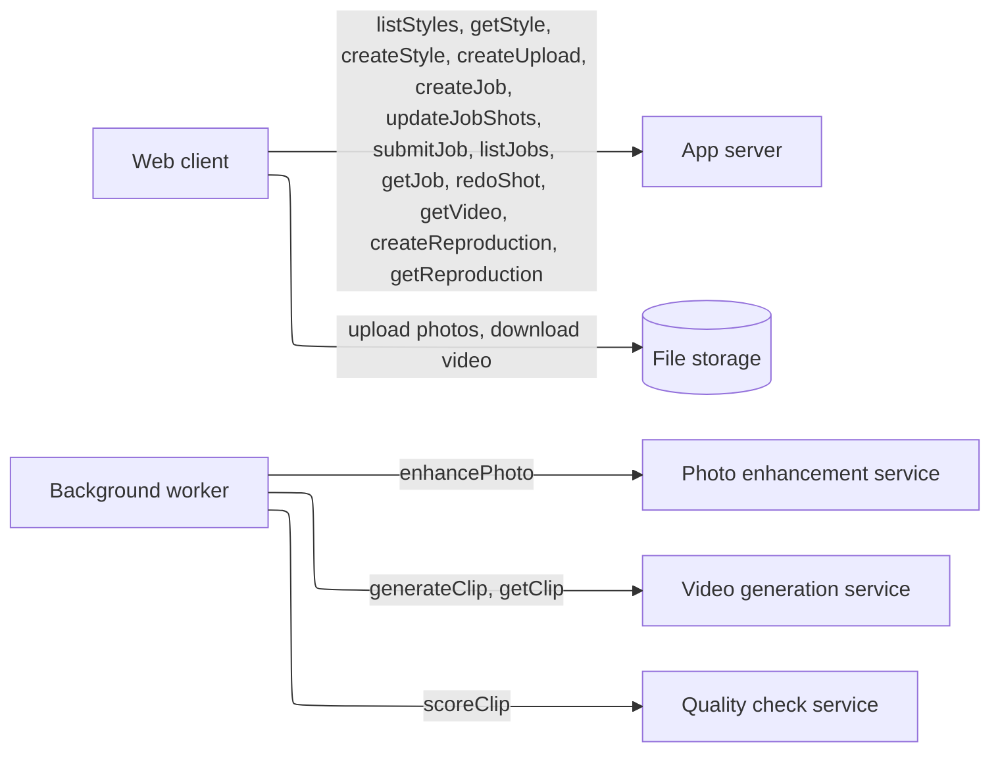

# HIGH_LEVEL_DESIGN.md — AutoHDR Photo-to-Video

**What this document is.** The parts the system needs and why, sized to the load it actually has. It names kinds of component, not products; `STACK.md` picks the products. How the code is organized inside the app is `ARCHITECTURE.md`'s. Requirement IDs refer to `REQUIREMENTS.md`. **[assumed]** marks an answer taken without confirmation; each is listed in §7.

## Summary

- **Load:** 1 user, 1 job at a time (SC-1). About 12 test jobs plus a few demo runs in total, so under 50 jobs over the project. Peak is about 0.2 browser requests/s. Each job is 10–30 minutes of work that is almost all waiting on outside AI services. About 10 GB of files in total (55 GB worst case, §2).
- **Design:** One app server, one background worker, one database, file storage, and three outside AI services (video, photo enhancement, quality check). The job queue is a table in the database.
- **Wireframe:** [Photo to Video wireframe](https://claude.ai/artifact/Y9f7bkitn6dqRLvP5sN5vH), clickable: Styles, New video (upload), Jobs, Job (running, waiting, stopped, partly failed, ready), Create a style, Original vs reproduction. Use the Tweaks panel to jump to each state.
- **Next as it grows:** final for the demo. The scaling write-up (GC-7) names two pieces for more than one user: a real queue with more workers, and a paid tier at the outside services. Triggers are in §5.
- **Cost:** no spend limit for now (GC-3). Own boxes about $6–8/month; the video service is the cost driver: about $7 per job first pass, up to $26–52 worst case (§6, from `STACK.md`), recorded per job (CO-1).



## 1. Sizing answers

| # | Question | Answer | Source |
|---|---|---|---|
| 1 | Users now, growth, peak | 1 user at a time, no growth planned; the scaling is explained in writing, not built. Peak is the demo itself, with one browser. | SC-1, SC-2, GC-7 |
| 2 | Read- or write-heavy | Neither in the usual sense. Browser reads (status polling) outnumber writes about 100:1, but the real work is long jobs calling outside services. The heaviest interaction is the job itself (I-4). | FR-1.3, PF-1 |
| 3 | Data that can never be lost | None. Uploads, styles and videos only need to last through the demo. One exception worth keeping: the pre-generated demo job and the demo styles must survive until the demo (DE-4). | U§7, U§10, DE-4 |
| 4 | Latency expected | Screens: under 1 s. Job: median 10 min, at most 30 min. Error message: within 60 s. See §2. | PF-1, PF-2, RL-1 |
| 5 | Cost ceiling | None for now; a limit may be set later (user, 2026-10-17). Cost is recorded per job so one can be enforced. | GC-3, CO-1 |

## 2. Interactions and load

| # | Interaction | R/W | How often | Peak/s | Expected latency | Data touched | Can be lost? | Source |
|---|---|---|---|---|---|---|---|---|
| I-1 | See the style library | R | ~1 per session | <0.1 | ≤ 1 s | Style, Song | No (demo styles kept) | FR-1.2 |
| I-2 | Upload a photoshoot | W | ~1 per job, up to 40 photos | <0.1 | Upload finishes as fast as the connection allows; page responds ≤ 1 s | Photoshoot, Photo | Only through the demo | FR-1.1, DE-2 |
| I-3 | Submit a job | W | ~1 per job | <0.1 | ≤ 1 s to accept | Job | Only through the demo | FR-1.3 |
| I-4 | Make the video (system, in the background) | W | 1 job at a time | — | median 10 min, max 30 min | Job, Job shot, Attempt, Video | Only through the demo | FR-1.4–1.8, PF-1, PF-2 |
| I-5 | Check job status (browser polls) | R | every 5 s while a job page is open | 0.2 | ≤ 1 s | Job, Job shot | — | FR-1.3 |
| I-6 | List jobs, open a past job | R | a few per session | <0.1 | ≤ 1 s | Job | No (demo job kept) | FR-1.3 |
| I-7 | Play and download the video | R | ~1 per job | <0.1 | Starts in a few seconds | Video | Only through the demo | FR-1.9 |
| I-8 | Create a style (demo-photoshoot method) | W | 2–3 per project | <0.1 | Save ≤ 1 s | Style, Style shot, Song, Photoshoot | Kept through the demo | FR-2.1, FR-2.2 |
| I-9 | Reproduce a style on its demo shoot or another shoot, compare side by side | W then R | about 3 per style | <0.1 | Same as I-4 | Style, Job, Video | Kept through the demo | FR-2.3, FR-2.4 |
| I-11 | See and change which photo fills each shot slot before submitting | W | ~1 per job | <0.1 | ≤ 1 s | Job, Job shot, Photo | Only through the demo | FR-1.10 |
| I-12 | Redo one shot of a finished video | W | a few per project | <0.1 | One shot plus re-cut, about 2 min | Job shot, Attempt, Video | Only through the demo | FR-1.12 |
| I-10 | Apply a saved style to another photoshoot | W | same as I-3 | — | same as I-3 | Style, Job | — | FR-2.5 |

**Arithmetic.**
- Browser requests: 1 user × 1 poll per 5 s = 0.2/s while a job page is open. Everything else is a few per minute. Total peak under 1/s.
- Jobs: 12 test jobs (GC-6) + about 3 demo styles × 2 runs + about 20 retries of whole jobs while building = under 50 jobs.
- Files per job (upper bound from DE-2): 40 photos × 25 MB = 1 GB. Typical shoot: 28 photos × 5 MB = 140 MB. A video of 6–8 shots: about 50 MB. So worst case under 50 jobs × 1.1 GB = 55 GB; typical about 10 GB. Both fit a free file-storage tier or local disk with room to spare; the worst case does not, so the worker deletes a job's source photos after the demo (see §7).
- Calls to outside services per job, worst case, with 8 shots and up to 3 regenerations each (QC-2): photo enhancement 8 (one per shot), video generation 8 × 4 = 32, quality check 32. First pass only: 8 + 8 + 8. A job's time is dominated by video generation. Measured: Veo 3.1 takes 48–88 s per clip and 12 clips in parallel all finished within 4.5 min (`VIDEO_RESEARCH.md` §7). With a job's shots in parallel, 4 rounds of about 110 s (clip plus check) is about 8 min, inside PF-1. One after another, the worst case is about 59 min, so shots of a job run in parallel.
- Provider rate limits and per-second price are the real ceiling, not our servers. Cost per job is in §6, from `STACK.md`.

Load is a single browser and a few jobs. One small app server and one database handle it with more than 100× headroom. The design is shaped by the long wait on outside services, not by traffic.

## 3. Core entities

| Entity | What it is | Key attributes | Relations | Durability | Growth |
|---|---|---|---|---|---|
| Song | A Creative Commons non-commercial track | title, artist, license, source URL (GC-5) | 1 to n Style | keep through demo | <10 |
| Style | A saved storyboard plus its song | name, song, demo photoshoot, original video | has Style shots; belongs to a Song | keep through demo | 2–3 |
| Style shot | One slot in a style | order, room or subject, photo-edit prompt, movement name, movement prompt, speed, model, place in song, cut time, transition into the next shot | belongs to Style | keep through demo | 5–8 per style |
| Photoshoot | The photos uploaded for one property | uploaded at | has Photos | disposable | <50 |
| Photo | One uploaded image | file reference, type, size | belongs to Photoshoot | disposable | ≤ 40 per shoot |
| Job | One run of photoshoot + style | status, style, photoshoot, submitted, finished, total time, stop reason | has Job shots, one Video | disposable (demo job kept) | <50 |
| Job shot | One shot of a job | style shot, photo (assigned, changeable before submit), enhanced photo reference, status, failure reason | belongs to Job; has Attempts | disposable | 5–8 per job |
| Attempt | One try at making a shot | prompt, model used, clip reference, check score, pass or fail | belongs to Job shot | disposable | up to 4 per shot (OB-1, OB-2) |
| Video | The finished file | file reference, length | belongs to Job | disposable (demo job kept) | <50 |

```mermaid
---
config:
  layout: elk
---
erDiagram
  SONG ||--o{ STYLE : "plays in"
  STYLE ||--|{ STYLE_SHOT : "has"
  PHOTOSHOOT ||--|{ PHOTO : "contains"
  STYLE ||--o{ JOB : "applied in"
  PHOTOSHOOT ||--o{ JOB : "used by"
  JOB ||--|{ JOB_SHOT : "has"
  STYLE_SHOT ||--o{ JOB_SHOT : "fills"
  PHOTO ||--o{ JOB_SHOT : "feeds"
  JOB_SHOT ||--|{ ATTEMPT : "tries"
  JOB ||--o| VIDEO : "produces"
```

**Access patterns**

| Read | Entities combined | How | At this scale |
|---|---|---|---|
| I-1 library | Style, Song | list with the song's title | fine as a query |
| I-5, I-6 job status and list | Job, Job shot | filter by job, sort by order | fine as a query |
| I-9 comparison table | Style shot, Job shot, Attempt | join by shot slot | fine as a query (tens of rows) |
| EV-1, EV-2 reports | Job, Job shot, Attempt | scan all jobs | fine as a query (under 50 jobs) |

## 4. API operations

Grouped by the component that **serves** each operation, with who **calls** it. Routes are sketches; exact contracts are `ARCHITECTURE.md`'s.



### 4.1 App server

| Operation | Called by | Input | Output | R/W | Latency class | Sync / async | Serves |
|---|---|---|---|---|---|---|---|
| `listStyles` — `GET /styles` | Web client | — | styles with song and shot count | R | ≤ 1 s | sync | I-1, FR-1.2 |
| `getStyle` — `GET /styles/{id}` | Web client | style id | style, its shots, its song | R | ≤ 1 s | sync | I-1, I-9 |
| `listSongs` — `GET /songs` | Web client | — | tracks with license and source | R | ≤ 1 s | sync | I-8, GC-5 |
| `createStyle` — `POST /styles` | Web client | name, song, demo photoshoot, original video | Style (draft) | W | ≤ 1 s | sync | I-8, FR-2.1, FR-2.2 |
| `updateStyleShots` — `PUT /styles/{id}/shots` | Web client | edited shot rows | Style | W | ≤ 1 s | sync | I-8 |
| `createUpload` — `POST /photoshoots` | Web client | file names, sizes, types | Photoshoot, signed upload links; refusal reasons for bad files | W | ≤ 1 s | sync | I-2, FR-1.1, DE-2 |
| `createJob` — `POST /jobs` | Web client | photoshoot, style | Job (draft) with a proposed photo for each shot slot, and which slots reuse a photo or are skipped | W | ≤ 1 s | sync | I-3, I-11, FR-1.10 |
| `updateJobShots` — `PUT /jobs/{id}/shots` | Web client | photo per shot slot | Job (draft) | W | ≤ 1 s | sync | I-11, FR-1.10 |
| `submitJob` — `POST /jobs/{id}/submit` | Web client | job id | Job (queued; says it is waiting if another job runs) | W | ≤ 1 s | sync accept; the work is async | I-3, FR-1.3, SC-1 |
| `restartJob` — `POST /jobs/{id}/restart` | Web client | stopped job id | Job (queued; finished shots kept) | W | ≤ 1 s | sync accept | FR-1.5 |
| `redoShot` — `POST /jobs/{id}/shots/{n}/redo` | Web client | job id, shot | Job shot (queued) | W | ≤ 1 s | sync accept; work async | I-12, FR-1.12 |
| `listJobs` — `GET /jobs` | Web client | — | jobs with status | R | ≤ 1 s | sync | I-6, FR-1.3 |
| `getJob` — `GET /jobs/{id}` | Web client | job id | status, shots with status and failure reason, stop reason, time taken | R | ≤ 1 s | sync | I-5, FR-1.5, RL-1 |
| `getVideo` — `GET /jobs/{id}/video` | Web client | job id | signed download link | R | ≤ 1 s | sync | I-7, FR-1.9 |
| `createReproduction` — `POST /styles/{id}/reproductions` | Web client | style id, photoshoot (the demo shoot or another) | Job on that photoshoot | W | ≤ 1 s | sync accept; work async | I-9, FR-2.3 |
| `getReproduction` — `GET /styles/{id}/reproductions/{job}` | Web client | style id, job id | original and reproduction links, per-shot checks (song, cut time, movement name, transition, flagged) | R | ≤ 1 s | sync | I-9, FR-2.4 |

**Inside the app server (no caller):** labelling a new photoshoot's rooms in the background through the quality-check service, so slots can be filled (FR-1.10). `ARCHITECTURE.md` holds the contracts, including renamed external operations (`editPhoto`, `checkClip`) and the supporting operations added there (`completeUpload`, `getPhotoshoot`, `setOriginal`).

### 4.2 Background worker

The worker does not take calls. It reads the database for work.

**Inside the worker (no caller):**

| Work | Trigger | Does | Serves |
|---|---|---|---|
| Run next job | A queued job (or redo) exists and no job is running | Picks the oldest queued job, marks it running. All shots in parallel: edit the photo, generate the clip, score it, regenerate up to 3 times if flagged, record every attempt. Cuts the clips to the style's cut times and transitions over the song. Marks the job ready, or ready with failed shots, or stopped. A redo runs one shot, then re-cuts. | I-4, I-12, FR-1.4–1.8, QC-2, RL-3, PF-1 |
| Report provider failure | An outside service returns an error or a limit | Marks the shot or job with the reason within 60 s, keeps finished shots, stops without retrying into a charge | RL-1, RL-2, CO-1 |
| Compare reproduction | A reproduction job is ready | Detects the cut times in both videos and compares them, the song, the movement names and the transitions; stores the per-shot result | VR-2, VR-3, VR-6, FR-2.4 |

### 4.3 External services

| Operation | Called by | Input | Output | Latency class | Serves |
|---|---|---|---|---|---|
| `enhancePhoto` | Worker (run next job) | photo, the style shot's photo-edit prompt (composition, lens, angle, light) | edited photo | seconds to a minute | FR-1.8 |
| `generateClip` / `getClip` | Worker (run next job) | edited photo as first frame, movement prompt, length (the next allowed length up from the cut: 4, 6 or 8 s on Veo) | clip, delivered later; the worker polls | about 1 min | FR-1.4 |
| `scoreClip` | Worker (run next job) | clip, frames from it, source photo | score for "looks AI-generated" and "matches source", counts of people and fixtures | seconds | FR-1.7, QC-1, VR-5 |

## 5. Components

### Web client

**Why it exists:** the photographer works in a desktop browser (FR-1.1, DE-1). **Wireframe:** [Photo to Video wireframe](https://claude.ai/artifact/Y9f7bkitn6dqRLvP5sN5vH). **Screens:**
- **Styles:** cards for each style with song and a "Use this style" button, a "See reproduction" link and a "Create a style" link. Only demo styles exist; no empty state is needed.
- **New video (upload):** the chosen style, a drop zone, the photo grid. States: empty, photos ready, invalid files (names the file and the reason; submit stays off and says why). Then the shot-slot list: each slot's proposed photo, changeable, and which slots reuse a photo or are skipped (FR-1.10).
- **Jobs:** every job with its status; opens a job.
- **Job:** running (which shot, attempts), waiting (another job is running), stopped (names the shot and the reason, "Start again" keeps finished shots), ready with failed shot marked, ready. Shot table with status and reason, and "Redo this shot". Player, download and the song's credit once there is a video.
- **Create a style:** upload the demo photoshoot, name, song (with its licence), the original video, and an editable shot table (photo, photo edit, movement name, speed, cut time, transition); save and run a reproduction. The wireframe still shows three methods; v1 builds only this one (REQUIREMENTS 0a #5).
- **Original and reproduction:** pick the reproduction (demo shoot or another shoot), two players, a play-both button, a per-shot table of checks (song, cut time, movement name, transition, flagged), keep or edit.
- No accounts (one shared passphrase), no phone layout (FR-3.2, FR-3.4).

### App server

**Why it exists:** serves the operations in §4.1; a second job is queued and shown as waiting (SC-1). **Holds / does:** no state of its own; one background task, labelling photos. An Evals command-line process of the same codebase runs the EV-1 and EV-2 jobs. **Provided by platform:** HTTPS and restarts on a managed host; on the builder's machine, neither is needed for the demo.

### Background worker

**Why it exists:** one job takes 10–30 minutes (PF-1), longer than any web request can stay open, and an outside failure must be retried or reported per shot (RL-1, RL-3). That is the §4 async split. **Holds / does:** runs one job at a time, so one worker suffices for SC-1. **Provided by platform:** no; it is a second process of the same codebase. A separate queue broker is not added: the job table is the queue (cheaper first step from the ladder), because there is one worker and one job at a time.

### Database

**Why it exists:** every entity in §3 and the job log that OB-1 and OB-2 need. **Holds / does:** styles, jobs, shots, attempts. Under 10,000 rows. **Provided by platform:** backups, if the host gives them; none are required (nothing is "never lose").

### File storage

**Why it exists:** photos, clips and videos are large and do not belong in the database (§2 sizes: up to 1 GB per job). **Holds / does:** uploads, enhanced photos, clips, final videos, the songs. The browser sends and receives files directly through signed links so the app server never carries video. **Provided by platform:** the local disk would do for the demo; the kind stays "file storage" so `choose-stack` can pick.

### Photo enhancement service, Video generation service, Quality check service

**Why they exist:** FR-1.8 (improve the photo), FR-1.4 (movement from a still), FR-1.7 and QC-1 (catch visibly AI shots). They are outside services from the approved list, or on a free tier if outside it (GC-4). They are the slowest and most limited boxes: speed, failure rate and free allowance live on the provider's side (KEY_METRICS guarantees). **Holds / does:** nothing of ours. **Provided by platform:** n/a.

### What to add next

For one user at a time the demo design is final. SC-2 asks for the written explanation of what changes to run N jobs; these are the pieces, with the measurable trigger that justifies each.

| Next piece | What breaks first | Add when (measurable) |
|---|---|---|
| Real queue and several workers | One worker runs one job at a time; the second job waits for the first, up to 30 min | Jobs waiting more than 5 min on the median, or a requirement for more than 1 job at once (SC-1 raised) |
| Higher rate-limit tier at the outside services | Per-account rate limits slow or stop jobs | More than 1 job in 10 stops or slows past PF-1 on a limit |

## 6. Cost envelope

| Component | Now | At horizon |
|---|---|---|
| App server, worker, database, file storage | about $6–8/month (Railway Hobby plus bucket) | same |
| Photo enhancement, quality check | about $0.40–0.65 per job | same |
| Video generation | first pass of 8 four-second Veo 3.1 clips at $0.20/s: $6.40 (about $9.60 with 6 s clips); with up to 3 regenerations per shot, up to $25.60 (4 s) or $51.20 (8 s) | under 50 jobs: about $320–480 typical |
| **Total** | **about $7 per job typical, up to $26–52 worst case** | **about $340–500 over the project plus about $25 hosting — no limit set (GC-3)** |

Prices are OpenRouter's listed prices read on 2026-10-18; `STACK.md` holds the breakdown. Veo 3.1 costs the same at 720p and 1080p, so output is 1080p (DE-5). Cost per job is recorded (CO-1) so a limit can be added.

## 7. Open questions and upstream fixes

| Item | Why it matters | Resolved by |
|---|---|---|
| Measured: 12 clips in flight at once, 48–88 s each on Veo 3.1 (`VIDEO_RESEARCH.md` §7) | Sizes the parallel-shot estimate against PF-1 | Recheck on the first full job |
| Source photos need not be deleted for space: 55 GB in the bucket is under $1/month (`STACK.md` §4) | Worst case is 55 GB | Resolved |
| A second job is queued, not refused | Decides one screen state | Resolved: SC-1 says queued |
| Jobs list | The wireframe's Jobs screen | Applied: REQUIREMENTS FR-1.11 |
| "Start again" on a stopped job | Wireframe error state | Applied: REQUIREMENTS FR-1.5 |
| Editable shot rows before saving a style | Wireframe create-style screen | Applied: REQUIREMENTS FR-2.1 |
| Comparison screen checks | Wireframe; VR-2 to VR-6 need somewhere to show their result | Applied: REQUIREMENTS FR-2.4 |
| The wireframe still shows three authoring methods, no shot-slot assignment and no "Redo this shot" | Screens drift from FR-1.10, FR-1.12, FR-2.1 | Update the wireframe before stories are written |
| Spend limit may be set later | Changes the cost check and may need a "stop at limit" row | User; add a requirement row and a cost-per-video metric (KEY_METRICS.md) when it is set |
