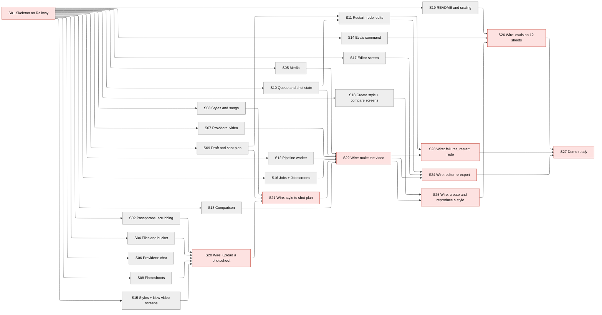

# Story map — AutoHDR Photo-to-Video

Arrows point from a story to the stories it unblocks. Red = human demo (story 1 and wiring stories); grey = module story checked by agents. No story waits on a blocker, so none has a dashed border.
Demo order: S01 → S20 → S21 → S22 → S23 + S24 + S25 (one window) → S26 → S27.

## Blockers
| # | Blocks stories | What is needed | Who decides | Source |
|---|---|---|---|---|
| 1 | S01 (deploy) | Railway Hobby account, one bucket per environment, bucket CORS for the app's address and localhost | Candidate, under an hour, start now | STACK §16 |
| 2 | S20, S21, S22 (real calls) | OpenRouter key with credits for Nano Banana, Gemini, Claude and Seedance; BYOK for Veo on; key spend limit "include BYOK"; Google Cloud budget alert | Candidate, under an hour, before the 10-19 morning window | STACK §16 |
| 3 | S20 (real data), S26 | The 12 test shoots downloaded from the PRD's Dropbox link to a folder outside the repo (GC-9) | Candidate | GC-6, GC-9 |
| 4 | S21 (seeded presets), S25 | 2–3 BY-NC or BY-NC-SA songs picked from Free Music Archive with their licences recorded in the seed manifest | Candidate, a few hours, before the 10-19 evening window | STACK §16, GC-5 |
| 5 | none (all stories written to the architecture) | FR-1.6 says the failed shot is "marked" in the delivered video; the architecture leaves its slot out and marks it on the Job page. Stories follow the architecture | Candidate: reword FR-1.6 or change assembly | Architectural issue 1 |

No deadline is at risk or missed and no tradeoff is pending (see Timeline).

## Order
| # | Story | Kind | Blocked by | Review gate | Size | Checked by |
|---|---|---|---|---|---|---|
| 1 | S01 Skeleton on Railway | skeleton | none | human demo | L | Demo: deployed Styles page from stubs, `/healthz`, stub routes, green gate, empty metrics report |
| 2 | S02 Passphrase and log scrubbing | module | S01 | agents | S | pytest: requests with and without the passphrase; scrubbed logs |
| 3 | S03 Styles and songs | module | S01 | agents | M | pytest on the Library routes and seed command |
| 4 | S04 Files and bucket | module | S01 | agents | S | pytest with moto |
| 5 | S05 Media | module | S01 | agents | M | pytest on generated images, clips and a test tone |
| 6 | S06 Providers: chat | module | S01 | agents | L | pytest with mocked OpenRouter; hand-run live tests |
| 7 | S07 Providers: video | module | S01 | agents | L | pytest with mocked Videos API; one hand-run live clip |
| 8 | S08 Photoshoots | module | S01 | agents | M | pytest with stubbed Files, Media, labeller |
| 9 | S09 Draft and shot plan | module | S01 | agents | M | pytest with a stub planner |
| 10 | S10 Queue and shot state | module | S01 | agents | M | pytest on routes and the worker interface, threads at once |
| 11 | S12 Pipeline worker | module | S01 | agents | L | pytest running the worker on stubs with a fake clock |
| 12 | S13 Comparison | module | S01 | agents | M | pytest with seeded jobs and a stub cut detector |
| 13 | S15 Styles and New video screens | module | S01 | agents | M | Playwright on stubbed routes |
| 14 | S16 Jobs and Job screens | module | S01 | agents | M | Playwright on stubbed routes |
| 15 | S11 Restart, redo, edits | module | S09, S10 | agents | M | pytest with seeded finished and stopped jobs |
| 16 | S17 Editor screen | module | S01 | agents | M | Playwright on stubbed routes |
| 17 | S18 Create style and compare screens | module | S01 | agents | M | Playwright on stubbed routes |
| 18 | S14 Evals command | module | S01 | agents | M | pytest on synthetic shoots and seeded jobs |
| 19 | S19 README and scaling | module | S01 | agents | S | Agent follows README setup; scaling checked against SC-2 |
| 20 | S20 Wire: upload a photoshoot | wiring | S02, S04, S06, S08, S15 | human demo | M | Demo: drop a test shoot, see refused files and room labels |
| 21 | S21 Wire: style to shot plan | wiring | S03, S09, S20 | human demo | M | Demo: preset → edit text → real plan → edit cards → save as my style |
| 22 | S22 Wire: make the video | wiring | S05, S07, S10, S12, S13, S16, S21 | human demo | L | Demo: real job, second job waits, play, download, credit, metrics |
| 23 | S23 Wire: failures, restart, redo | wiring | S11, S22 | human demo | M | Demo: out of credit, Start again, worker restart, Redo this shot |
| 24 | S24 Wire: editor re-export | wiring | S11, S17, S22 | human demo | M | Demo: edit 4 shots, re-export remakes 2, within 10 min |
| 25 | S25 Wire: create and reproduce a style | wiring | S18, S22 | human demo | L | Demo: write a style, try it, set reference, reproduce, side by side |
| 26 | S26 Wire: evals on 12 shoots | wiring | S14, S19, S25 | human demo | L | Demo: import, EV-1 and EV-2 runs, reviewer sheet, report, README results |
| 27 | S27 Demo ready | wiring | S23, S24, S26 | human demo | S | Demo: live Veo check, live flow, offline video, deploys frozen |

## Timeline
Capacity: 5 agents at once (the lazy-orchestrator's limit) **[assumed]**; two demo windows a day, about 9 AM and 8 PM local **[assumed]**, the first on the evening of 2026-10-18; start 2026-10-18. Dates move with the windows.
Total: agent time 320–675 min (about 5.3–11.3 h), plus generation time for real jobs (below); last required demo 2026-10-21 evening on both the likely and high estimates.

| # | Story | Agent minutes (likely – high) | Built by (likely – high) | Demoed in window | Needed for |
|---|---|---|---|---|---|
| 1 | S01 | 20 – 45 | 10-18 evening, after blocker 1 | W1 10-18 evening | everything |
| 2–19 | S02–S19 (module stories, 5 at a time; S11 after S09 and S10) | 195 – 405 in total, about 40 – 105 elapsed | 10-18 night | — (agents) | the wiring stories |
| 20 | S20 | 10 – 20 | 10-18 night | W2 10-19 morning | S21 |
| 21 | S21 | 10 – 20 | 10-19 midday | W3 10-19 evening | S22 |
| 22 | S22 | 20 – 45, plus two real jobs of 10–30 min each | 10-19 night | W4 10-20 morning | S23, S24, S25 |
| 23 | S23 | 10 – 20, plus two short jobs | 10-20 midday | W5 10-20 evening | S27 |
| 24 | S24 | 10 – 20, plus one re-export of up to 10 min | 10-20 midday | W5 10-20 evening | S27 |
| 25 | S25 | 20 – 45, plus three real jobs of 10–30 min | 10-20 afternoon | W5 10-20 evening | S26 |
| 26 | S26 | 20 – 45, plus about 16 real jobs run one at a time, 10–30 min each (2.7–8 h) | 10-21 early morning | W6 10-21 morning | S27, GC-8 |
| 27 | S27 | 5 – 10 | 10-21 afternoon | W7 10-21 evening | GC-1 |

| External wait | Needed by story | Lead time | Start by |
|---|---|---|---|
| Railway account, buckets, CORS | S01 | under 1 h | now (10-18) |
| OpenRouter credits, BYOK, spend limit, Google Cloud budget alert | S06/S07 live tests, S20 | under 1 h | 10-18 evening |
| Download the 12 test shoots | S20, S26 | under 1 h | 10-18 evening |
| Pick 2–3 CC songs and record licences | S21, S25 | a few hours | 10-19 morning |
| Live Veo call on the demo day | S27 | minutes | 10-21 |

| Deadline | Date | Requires | Stories | Done by (high) | Status |
|---|---|---|---|---|---|
| GC-1 submission | 2026-10-21 11:59 PM local *(assumed)* | Every requirement; "try to drop nothing" (USERS §8) | S01–S27 | 10-21 evening window | **Met**, about 3–4 h before the deadline, with **no spare demo window**: a demo that has to be repeated pushes S27 past the deadline unless a third daily window (midday) is added |

## Design tradeoffs
None needed: every deadline is met on the high estimate. If a demo has to be repeated, the first move is more demo time (a midday window on 10-19 and 10-20), not a design change.

## Architecture coverage
| Element | Kind | ARCHITECTURE section | Owning story | Criterion | Extended by |
|---|---|---|---|---|---|
| listStyles `GET /api/styles` | route | Library → API | S03 | 4 | — |
| getStyle `GET /api/styles/{id}` | route | Library → API | S03 | 9 | — |
| listSongs `GET /api/songs` | route | Library → API | S03 | 1 | — |
| createStyle `POST /api/styles` | route | Library → API | S03 | 3 | — |
| updateStyle `PUT /api/styles/{id}` | route | Library → API | S03 | 8 | — |
| createUpload `POST /api/photoshoots` | route | Photoshoots → API | S08 | 1 | — |
| completeUpload `POST /api/photoshoots/{id}/complete` | route | Photoshoots → API | S08 | 4 | — |
| getPhotoshoot `GET /api/photoshoots/{id}` | route | Photoshoots → API | S08 | 6 | — |
| createJob `POST /api/jobs` | route | Jobs → API | S09 | 1 | — |
| replanJob `POST /api/jobs/{id}/plan` | route | Jobs → API | S09 | 9 | — |
| updateJobShots `PUT /api/jobs/{id}/shots` | route | Jobs → API | S09 | 7 | — |
| submitJob `POST /api/jobs/{id}/submit` | route | Jobs → API | S10 | 1 | — |
| listJobs `GET /api/jobs` | route | Jobs → API | S10 | 13 | — |
| getJob `GET /api/jobs/{id}` | route | Jobs → API | S10 | 6 | — |
| getVideo `GET /api/jobs/{id}/video` | route | Jobs → API | S10 | 14 | — |
| restartJob `POST /api/jobs/{id}/restart` | route | Jobs → API | S11 | 1 | — |
| redoShot `POST /api/jobs/{id}/shots/{position}/redo` | route | Jobs → API | S11 | 3 | — |
| editShot `PATCH /api/jobs/{id}/shots/{position}` | route | Jobs → API | S11 | 5 | — |
| exportJob `POST /api/jobs/{id}/export` | route | Jobs → API | S11 | 10 | — |
| setReference `POST /api/styles/{id}/reference` | route | Comparison → API | S13 | 5 | — |
| getReproduction `GET /api/styles/{id}/reproductions/{jobId}` | route | Comparison → API | S13 | 7 | — |
| `GET /healthz` | route | System-wide contracts → Health | S01 | 2 | S02 (stays open) |
| labelPhotoshoot (and relabel on app start) | job | Photoshoots → Jobs and messages | S08 | 6, 8 | — |
| planJob (and re-plan on app start) | job | Jobs → Jobs and messages | S09 | 2, 12 | — |
| runNextJob (worker loop) | job | Pipeline → Jobs and messages | S12 | 1 | — |
| Startup recovery, worker side | job | Data flows → Startup recovery | S12 | 15 | — |
| songs seed command | job | Library → `songs` | S03 | 1, 2 | — |
| `evals import` | job | Evals | S14 | 1 | — |
| `evals run --suite ev1 / ev2` | job | Evals | S14 | 2, 3 | — |
| `evals report` | job | Evals | S14 | 5, 6 | — |
| `songs` | table | Database schema | S03 | 1 | — |
| `styles` | table | Database schema | S03 | 3 | S13 (reference) |
| `photoshoots` | table | Database schema | S08 | 1 | — |
| `photos` | table | Database schema | S08 | 4 | — |
| `jobs` | table | Database schema | S09 | 1 | S10, S11 |
| `job_shots` | table | Database schema | S09 | 2 | S10, S11 |
| `attempts` | table | Database schema | S10 | 5 | — |
| `provider_calls` | table | Database schema | S06 | 8 | S07 |
| `cut_checks` | table | Database schema | S13 | 1 | — |
| Library.getStyle | interface | Library → Interface | S03 | 9 | — |
| Library.setReferenceJob | interface | Library → Interface | S03 | 10 | — |
| Photoshoots.listPhotos | interface | Photoshoots → Interface | S08 | 9 | — |
| Photoshoots.importPhotoshoot | interface | Photoshoots → Interface | S08 | 10 | — |
| Jobs.claimNextJob | interface | Jobs → Interface | S10 | 3 | — |
| Jobs.recoverInterrupted | interface | Jobs → Interface | S10 | 10 | — |
| Jobs.setShotState | interface | Jobs → Interface | S10 | 9 | — |
| Jobs.setShotPhoto | interface | Jobs → Interface | S10 | 16 | — |
| Jobs.startAttempt | interface | Jobs → Interface | S10 | 5 | — |
| Jobs.finishAttempt | interface | Jobs → Interface | S10 | 7 | — |
| Jobs.setShotResult | interface | Jobs → Interface | S10 | 6 | — |
| Jobs.finishJob | interface | Jobs → Interface | S10 | 11 | — |
| Jobs.stopJob | interface | Jobs → Interface | S10 | 8 | — |
| Jobs createJob / submitJob for Evals | interface | Jobs → Interface | S09 / S10 | 1 / 1 | S26 |
| Providers.labelPhotos | interface | Providers → Interface | S06 | 1 | — |
| Providers.planShots | interface | Providers → Interface | S06 | 2, 3 | — |
| Providers.editPhoto | interface | Providers → Interface | S06 | 4 | — |
| Providers.checkEdit | interface | Providers → Interface | S06 | 5 | — |
| Providers.checkClip | interface | Providers → Interface | S06 | 6 | — |
| Providers.generateClip | interface | Providers → Interface | S07 | 1, 2 | — |
| Providers.allowedLengths | interface | Providers → Interface | S07 | 3 | — |
| Providers.recoverCalls | interface | Providers → Interface | S07 | 6 | — |
| FakeProviders test double | interface | Providers → Calls out | S06 | 11 | S07 (8) |
| Media.crop16x9 | interface | Media | S05 | 1 | — |
| Media.thumbnail | interface | Media | S05 | 2 | — |
| Media.extractFrames | interface | Media | S05 | 3 | — |
| Media.probe | interface | Media | S05 | 6 | — |
| Media.assemble | interface | Media | S05 | 4, 5, 7 | — |
| Media.detectCuts | interface | Media | S05 | 4 | — |
| Files.presignUpload | interface | Files | S04 | 1, 2 | — |
| Files.presignDownload | interface | Files | S04 | 3, 4 | — |
| Files.put / get | interface | Files | S04 | 8 | — |
| Files.headObject | interface | Files | S04 | 5 | — |
| Comparison.recordCuts | interface | Comparison → Interface | S13 | 1–4 | — |
| Bucket key layout | external | Files → Calls out | S04 | 1, 8 | — |
| OpenRouter chat completions (edit, plan, checks, labels) | external | Providers → Calls out | S06 | 1–7 | — |
| OpenRouter Videos API | external | Providers → Calls out | S07 | 1, 2, 4 | — |
| Railway Storage Bucket (real) | external | Environments | S04 | 6 | S20 (1) |
| Styles screen | screen | HLD §5 Web client | S15 | 1, 2 | — |
| New video screen (text, song, upload, plan) | screen | HLD §5 Web client | S15 | 2–11 | — |
| Jobs screen | screen | HLD §5 Web client | S16 | 1, 2 | — |
| Job screen (all states) | screen | HLD §5 Web client | S16 | 3–11 | — |
| Editor screen | screen | HLD §5 Web client | S17 | 1–8 | — |
| Create a style screen | screen | HLD §5 Web client | S18 | 1–6 | — |
| Reference and reproduction screen | screen | HLD §5 Web client | S18 | 7–10 | — |
| Access (passphrase) | system-wide | Access | S02 | 1–4 | — |
| Error format | system-wide | System-wide contracts | S01 | 6 | — |
| Times | system-wide | System-wide contracts | S16 | 12 | — |
| Database (foreign keys, busy timeout) | system-wide | System-wide contracts | S01 | 14 | — |
| Blocking work | system-wide | System-wide contracts | S01 | 15 | — |
| Scrubbing | system-wide | System-wide contracts | S02 | 5, 6 | S04 (7), S06 (10) |
| Backup and restore (offline demo copy) | system-wide | System-wide contracts | S27 | 3 | — |
| Processes | system-wide | System-wide contracts | S01 | 7 | — |
| Configuration and `.env.example` | system-wide | System-wide contracts | S01 | 8 | — |
| Environments (Local, Test and CI, Production) | system-wide | Environments and the regression gate | S01 | 1, 9, 13 | S27 (4) |
| Regression gate | system-wide | Environments and the regression gate | S01 | 9–11, 16 | every story |
| Metrics report (one panel per metric) | measurement | Measurement | S01 | 12 | S22 (10) |
| Video wait time timestamps | measurement | Measurement | S10 | 1, 11 | — |
| Time to tell the user about a provider error | measurement | Measurement | S12 | 11 | — |
| Regeneration attempts per shot | measurement | Measurement | S10 | 5 | — |
| Re-export time | measurement | Measurement | S11 | 10 | S24 (3) |
| Shots dropped because every attempt was flagged | measurement | Measurement | S12 | 3 | — |
| Cut-time error | measurement | Measurement | S13 | 1 | — |
| Cost per call and per job | measurement | Measurement | S06 | 8, 9 | S07 (5), S10 (11) |
| Reviewer sheet | measurement | Measurement | S14 | 4 | — |
| Access: no route but `/healthz` without the passphrase | Must hold | Access | S02 | 1 | — |
| Access: passphrase never logged | Must hold | Access | S02 | 5 | — |
| Only the owner writes each table (all modules) | Must hold | every module | S01 | 16 | — |
| Library: a style holds text and a song only | Must hold | Library | S25 | 7 | — |
| Library: songs are BY-NC or BY-NC-SA | Must hold | Library | S03 | 2 | — |
| Library: updating a style never changes a job | Must hold | Library | S09 | 10 | — |
| Photoshoots: no photo over 25 MB or another type | Must hold | Photoshoots | S08 | 2, 5 | — |
| Photoshoots: a photo's file key never changes | Must hold | Photoshoots | S08 | 12 | — |
| Photoshoots: photos never in the repository | Must hold | Photoshoots | S01 | 11 | S26 (7) |
| Jobs: at most one job running | Must hold | Jobs | S01 | 4 | S10 (3) |
| Jobs: a job's copied shot fields never change | Must hold | Jobs | S09 | 10 | see architectural issue 2 |
| Jobs: at most 4 attempts per shot per round | Must hold | Jobs | S10 | 5 | — |
| Jobs: a failed shot has a reason and is listed | Must hold | Jobs | S10 | 6 | — |
| Jobs: never ready with a shot pending or in flight | Must hold | Jobs | S10 | 12 | — |
| Jobs: only the final passed clip is returned | Must hold | Jobs | S10 | 7 | — |
| Jobs: a re-export never changes an untouched shot | Must hold | Jobs | S11 | 12 | S24 (4) |
| Jobs: departures from the plan are shown on the shot | Must hold | Jobs | S16 | 8 | S22 (12) |
| Pipeline: a clip is used only if its check passed | Must hold | Pipeline | S12 | 2 | — |
| Pipeline: one shot failing never stops the others | Must hold | Pipeline | S12 | 4 | — |
| Pipeline: provider errors reported within 60 s | Must hold | Pipeline | S12 | 11 | S23 (1) |
| Pipeline: no clip after the deadline | Must hold | Pipeline | S12 | 9 | — |
| Pipeline: temporary files never on the volume | Must hold | Pipeline | S12 | 18 | — |
| Providers: API key only in the request header | Must hold | Providers | S06 | 10 | — |
| Providers: no clip left undownloaded | Must hold | Providers | S07 | 6 | S23 (4) |
| Media: cuts are re-encoded | Must hold | Media | S05 | 4 | — |
| Files: the bucket is private | Must hold | Files | S04 | 6 | S20 (demo step 4) |
| Files: presigned links never logged | Must hold | Files | S04 | 7 | — |
| Comparison: a reference is a ready job from the style's text | Must hold | Comparison | S13 | 6 | — |
| Jobs failure: submit while another job runs | failure behaviour | Jobs → Failure behaviour | S10 | 2 | — |
| Jobs failure: worker restarted mid-job | failure behaviour | Jobs → Failure behaviour | S10 | 10 | S23 (3) |
| Pipeline failure: rate limited or timeout | failure behaviour | Pipeline → Failure behaviour | S12 | 17 | — |
| Pipeline failure: provider refuses | failure behaviour | Pipeline → Failure behaviour | S12 | 7 | — |
| Pipeline failure: out of credit | failure behaviour | Pipeline → Failure behaviour | S12 | 10 | S23 (1) |
| Pipeline failure: all 4 attempts flagged | failure behaviour | Pipeline → Failure behaviour | S12 | 3 | — |
| Pipeline failure: deadline reached | failure behaviour | Pipeline → Failure behaviour | S12 | 9 | — |
| Pipeline failure: assembly fails | failure behaviour | Pipeline → Failure behaviour | S12 | 13 | — |
| No shot passed → stopped | failure behaviour | Pipeline | S12 | 12 | — |
| Labelling failure → `label_failed` | failure behaviour | Photoshoots → Jobs and messages | S08 | 7 | S20 (5) |
| Plan failure → asked again once, then `failed` | failure behaviour | Jobs → planJob | S09 | 5, 6 | S21 (7) |
| recordCuts failure never fails the job | failure behaviour | Comparison → Interface | S13 | 3 | — |
| Media failure → MediaError | failure behaviour | Media | S05 | 8 | — |
| Provider errors → one set of kinds | failure behaviour | Providers → Calls out | S06 | 7 | S07 (4, 7) |

## Flow coverage
| Data flow (ARCHITECTURE trace) | Wiring story | Stubs it removes | Integration cases added to the gate |
|---|---|---|---|
| createUpload, browser upload, completeUpload, getPhotoshoot ("Upload a photoshoot") | S20 | Files, Media, labelPhotos in Photoshoots; Photoshoots routes behind New video | upload, complete, label, labeller error |
| listStyles, getStyle, listSongs, createStyle, createJob, replanJob, updateJobShots | S21 | getStyle, listPhotos, planShots, allowedLengths in Jobs; presignDownload in Library; Library and Jobs routes behind Styles and New video | createJob through planJob, invalid plan, missing style |
| submitJob, listJobs, getJob, getVideo, "Run next job" ("Make the video") | S22 | Jobs interface, Providers, Media, Files, recordCuts in Pipeline; presignDownload in Jobs; detectCuts and Files.get in recordCuts; Jobs routes behind Jobs and Job | full job with a flagged attempt and a failed shot |
| restartJob, redoShot, "Startup recovery" | S23 | restartJob and redoShot behind the Job screen | restart, redo, recovery; out of credit, rate limit, refusal |
| editShot, exportJob | S24 | getJob, getPhotoshoot, editShot, exportJob behind the Editor | edit and export, invalid edit, busy job |
| updateStyle, setReference, getReproduction ("Reproduce a style and compare") | S25 | routes behind Create a style and Reference and reproduction; Photoshoots in Library; setReferenceJob, Files, Media in Comparison's routes | createStyle, setReference, getReproduction; not-ready reference, no reference |
| Evals | S26 | importPhotoshoot, createJob, submitJob in Evals | import and run, a stopped job |
| Production on demo day | S27 | none left | the no-stub check |

## Requirement coverage
| Requirement | Kind | Threshold (quoted) | Story (or milestone) | Criterion |
|---|---|---|---|---|
| GC-1 | given | "complete by 2026-10-21, 11:59 PM local time" | Timeline (deadline, no work) | — |
| GC-2 | given | "One builder" | Timeline (team, no work) | — |
| GC-3 | given | "No spend limit is set for now" | S06 | 8 |
| GC-4 | given | approved list, or a free tier | S01 | 10 |
| GC-5 | given | "BY-NC or BY-NC-SA, not ND … shown with the video" | S03; S22 | 2; 7 |
| GC-6 | given | "The 12 PRD test photoshoots are the test set" | S26 | 1, 2 |
| GC-7 | given | written explanation of scaling | S19 | 3 |
| GC-8 | given | README with setup, design and results | S19; S26 | 1, 2; 6 |
| GC-9 | given | test photos "never committed to the repository" | S01; S26 | 11; 7 |
| FR-1.1 | functional | — | S20 | 1 |
| FR-1.2 | functional | — | S21 | 1 |
| FR-1.3 | functional | — | S22 | 4 |
| FR-1.4 | functional | — | S22 | 1, 6 |
| FR-1.5 | functional | — | S23 | 1, 2 |
| FR-1.6 | functional | — | S23 | 5 (see architectural issue 1) |
| FR-1.7 | functional | — | S22 | 8 |
| FR-1.8 | functional | — | S22 | 12 |
| FR-1.9 | functional | — | S22 | 5 |
| FR-1.10 | functional | — | S21 | 2, 5 |
| FR-1.11 | functional | — | S22 | 4 |
| FR-1.12 | functional | — | S23 | 6 |
| FR-1.13 | functional | — | S24 | 1 |
| FR-1.14 | functional | — | S24 | 1 |
| FR-1.15 | functional | — | S24 | 5 |
| FR-1.16 | functional | — | S24 | 2, 4 |
| FR-2.1 | functional | — | S25 | 1, 2 |
| FR-2.2 | functional | — | S25 | 3 |
| FR-2.3 | functional | — | S25 | 4 |
| FR-2.4 | functional | — | S25 | 5, 6 |
| FR-2.5 | functional | — | S21; S25 | 6; 4 |
| FR-3.2 | functional | — | S20 | 6 |
| FR-3.3 | functional (exclusion) | — | Icebox | — |
| FR-3.4 | functional (exclusion) | — | Icebox | — |
| FR-3.5 | functional (exclusion) | — | Icebox | — |
| FR-3.6 | functional (Gate) | — | S25 | 7 |
| VR-1 | non-functional | "At most 2 visibly AI-generated shots per delivered video; target 0" | S26 | 4 |
| VR-2 | non-functional | "cuts land within ±0.1 s of the shot plan's cut times" | S22; S25 | 6; 6 |
| VR-3 | non-functional | "100% of shots move as their plan says … 100% of the movements, transitions and pacing the style text names appear in the plan" | S21; S26 | 3; 4 |
| VR-4 | non-functional | "[tbd]; interim target 100% … floor 80%" | S26 | 4 |
| VR-5 | non-functional | "0 generated shots or edited photos add, remove or change a room, fixture or architectural feature" | S26; S12 | 4; 5 |
| VR-6 | non-functional | "100% of transitions in the video match the shot plan" | S26 | 4 |
| PF-1 | non-functional | "within 30 min of submitting" | S22; S26 | 1; 2 |
| PF-2 | non-functional | "Typical jobs finish within 10 min" | S26 | 2 |
| PF-3 | non-functional | regeneration uses "at most the remainder" of 30 min | S12 | 9 |
| PF-4 | non-functional | "up to 2 changed shots is playable within 10 min" | S24 | 3 |
| RL-1 | non-functional | "reported to the user within 60 s" | S23; S12 | 1; 11 |
| RL-2 | non-functional | "100% of failed shots appear in the result with a reason" | S10; S23 | 6; 5 |
| RL-3 | non-functional | "never stops the other shots" | S12; S23 | 4; 5 |
| OB-1 | non-functional | style, photo, prompts, model, attempts, result, total time | S22 | 9 |
| OB-2 | non-functional | every rejected shot "with the check's score" | S22 | 9 |
| QC-1 | non-functional | "[tbd]; interim target: catches ≥ 60%" | S26 | 5 |
| QC-2 | non-functional | "regenerated up to 3 times" | S10; S12 | 5; 3 |
| SC-1 | non-functional | "Supports 1 job at a time … a second job … is queued" | S22 | 3 |
| SC-2 | non-functional | what changes to run N jobs within PF-1 | S19 | 3, 4 |
| DE-1 | non-functional | "current desktop Chrome release" | S01 | 1 |
| DE-2 | non-functional | "JPG and PNG, up to 40 photos and 25 MB each" | S08; S20 | 2, 3; 3, 4 |
| DE-3 | non-functional | "without a GPU requirement" | S01 | 13 |
| DE-4 | non-functional | live, or "a pre-generated job is shown" | S27 | 2, 3 |
| DE-5 | non-functional | "1920×1080, 16:9 landscape, at the style's frame rate" | S05; S22 | 6; 5 |
| EV-1 | non-functional | 12 test shoots, per-video report | S26 | 2 |
| EV-2 | non-functional | each preset on ≥ 2 other shoots | S26 | 3 |
| CO-1 | non-functional | cost per call and per job; list price for BYOK | S06; S07; S10 | 8, 9; 5; 11 |
| CH-1 | non-functional | edit one shot "without regenerating the others" | S24 | 4 |
| CH-2 | non-functional | two jobs on separate capacity, "outputs match single-job runs" | S12 | 16 |

## Metric coverage
| Metric | Data it needs | Story that records it | Dashboard panel (story 1) | Wiring demo that shows it with real data |
|---|---|---|---|---|
| Video wait time (slowest), PF-1 | `first_submitted_at`, `first_finished_at` | S10 | metrics report panel 1 | S22 |
| Video wait time (typical), PF-2 | same | S10 | panel 2 | S26 (median over the 12) |
| Time to tell the user about a provider error, RL-1 | `provider_calls.finished_at`, `attempts.finished_at`, `jobs.finished_at` | S12 | panel 3 | S23 |
| Regeneration attempts per shot, QC-2 | `attempts` per shot and round | S10 | panel 4 | S22 |
| Shots dropped because every attempt was flagged, VR-1 proxy | `job_shots.failure_reason` | S12 | panel 5 | S22 |
| Cut-time error against the style, VR-2 | `cut_checks.error_s` | S13 | panel 6 | S22, S25 |

## Assumptions
- Capacity: 5 agents at once and two demo windows a day — the whole timeline; with one window a day the last demo slips to about 10-24 and GC-1 is missed.
- ARCHITECTURE A-8: a clip recovered after a restart is kept but not reused — S07, S23.
- ARCHITECTURE open question 2 [verify]: Gemini accepts the clip inline — S06 (checkClip); if not, frames only, same ClipCheck.
- ARCHITECTURE open question 6 [verify]: Railway enforces presigned size limits — S04, S20; completeUpload's check covers either way.
- ARCHITECTURE open question 7 [verify]: BYOK is marked in the response — S06, S07; otherwise the `BYOK_MODELS` setting.
- ARCHITECTURE A-3 and A-10: labelling and planning run in the app process — S08, S09.
- The metrics "dashboard" is a report command over the tables, since STACK §13 says every metric is a query over the job log tables — S01, S22.
- Preset styles for the demos are written by the candidate from the wireframe's examples and created through createStyle — S21, S25.

## Icebox
- FR-3.3 creator ratings, reviews, payments, credits — REQUIREMENTS FR-3, USERS §7.
- FR-3.4 phone layout — REQUIREMENTS FR-3, USERS §7.
- FR-3.5 past-video upload and storyboard-outline authoring — REQUIREMENTS 0a #5.
- A spend limit — GC-3 and ARCHITECTURE open question 12 put it later.
- Several workers and a real queue — HLD §5 "What to add next"; only described in S19.

## Feasibility checks
- OpenRouter Videos API with Veo 3.1 and Seedance 2.0 makes 1080p clips from a first frame, 12 in flight, 48–88 s each — `VIDEO_RESEARCH.md` §7 and `tools/gen_clip.py`, run 2026-10-17/18.
- The stack's pieces fit together — STACK.md compatibility check, 2026-10-18.
- Not checked live: the planner's plan quality (ARCHITECTURE open question 1) and Gemini clip input (open question 2); both are first exercised in S21 and S22.

## Architectural issues
1. **FR-1.6 vs assembly.** REQUIREMENTS FR-1.6: "the rest of the video is still delivered with the failed shot marked". ARCHITECTURE Pipeline: "A failed or skipped shot leaves its slot out and the video is marked `ready_with_failures`". The stories mark the failed shot on the Job page beside the player (S16 criterion 7), not inside the video. An amendment would either reword FR-1.6 to "marked on the job page" or have assembly keep a marked slot.
2. **Jobs Must hold "copied shot fields never change after creation (CH-1)".** It conflicts with the editor: editShot changes shot fields after a job finishes (FR-1.13–FR-1.16), and the same section says plan fields are changed "after that only by editShot". The stories test what the rest of the architecture means: a job keeps its own text and plan when a style changes (S09 criterion 10), and an untouched shot never changes on re-export (S11 criterion 12). An amendment would reword the hold to "change only through updateJobShots before submit and editShot after".
3. **The Job type has no video version.** Re-export and redo raise `video_version`, and S23 and S24 show "the version goes up", but `Job.video` in Shared types carries only `{ url, durationS, width, height }`. An amendment would add `version` to `Job.video`.
